# Case study: does portfolio insurance raise geometric return?

Mark Spitznagel's test for a safe haven is simple: hold it only if adding it raises the compound growth rate (CAGR) of the whole portfolio. This case study runs that test, and the critics' tests, on every safe-haven candidate in InsurePort's catalog, on three portfolios, over 36.8 years of daily data. It asks four questions: does insurance raise geometric return, for which sleeves, at what size, and how robust is the answer?

Every number below is copied from [`figures/case_study_tables.md`](figures/case_study_tables.md), which `python scripts/case_study.py` writes in the same run that draws the figures. Option prices are **model-priced** (Black-Scholes-Merton on a VIX / SKEW volatility surface, `src/insureport/pricing.py`), not traded quotes, so every option result is conditional on that pricer. Cboe index levels before each index's launch are Cboe back-tests. Universa figures are self-reported, hypothetical and window-dependent. This is research, not investment advice; InsurePort is not affiliated with Universa Investments, Cboe or Cambria.

## Summary of findings

Under model prices, buying index puts did not raise the compound growth rate of any portfolio tested. All six model-priced option presets (the Universa-style 96.67/3.33 portfolio and its 98/2 variant, the *Dao of Capital* ch. 9 prototype, a 10/25 put spread, a 5% protective put and a 95-110 collar), the TAIL proxy and the real Cboe PPUT and CLL index levels have w* = 0.00%: the CAGR-maximizing weight is none, and the verdict is "not cost-effective" on the S&P 500, 60/40 and concentrated-tech cores alike. On the S&P 500 core the only positive weights come from gold (w* 35.00%, +35 bp a year, cost-effective but fragile), trend following (75.00%, +31 bp, not cost-effective because its 25-year bootstrap median is negative) and the Cboe VXTH index (10.00%, +1 bp, fragile). On the 60/40 core, trend, gold, VXTH and PPUT3M reach w* = 100.00%: they beat the 60/40 by replacing it, and their volatility tax rises rather than falls (table t03c), so that gain is more equity-like return over this sample, not insurance. Nothing raises the concentrated-tech core's CAGR. The far-out-of-the-money verdicts depend on the pricer: one assumption at a time, the Dao preset's dCAGR at 0.50% ranges from -331 bp to +498 bp (table t08), so "not cost-effective under model prices" is the verdict, and the model's far wing is what decides it.

**Table t00_summary: w*, dCAGR at w* and the verdict per candidate and core.**

w* = the CAGR-maximizing sleeve weight (no cap); dCAGR = CAGR at w* minus the core's; the verdict is catalog.evaluate's.

| candidate | archetype | spx: w_star | spx: d_cagr_bp | spx: verdict | 6040: w_star | 6040: d_cagr_bp | 6040: verdict | tech: w_star | tech: d_cagr_bp | tech: verdict |
|---|---|---|---|---|---|---|---|---|---|---|
| universa_model | insurance | 0.00% | +0 | not cost-effective | 0.00% | +0 | not cost-effective | 0.00% | +0 | not cost-effective |
| universa_2023 | insurance | 0.00% | +0 | not cost-effective | 0.00% | +0 | not cost-effective | 0.00% | +0 | not cost-effective |
| dao_ch9 | insurance | 0.00% | +0 | not cost-effective | 0.00% | +0 | not cost-effective | 0.00% | +0 | not cost-effective |
| put_spread | insurance | 0.00% | +0 | not cost-effective | 0.00% | +0 | not cost-effective | 0.00% | +0 | not cost-effective |
| prot_put | insurance | 0.00% | +0 | not cost-effective | 0.00% | +0 | not cost-effective | 0.00% | +0 | not cost-effective |
| collar | insurance | 0.00% | +0 | not cost-effective | 0.00% | +0 | not cost-effective | 0.00% | +0 | not cost-effective |
| pput_idx | insurance | 0.00% | +0 | not cost-effective | 0.00% | +0 | not cost-effective | 0.00% | +0 | not cost-effective |
| pput3m_idx | insurance | 0.00% | +0 | not cost-effective | 100.00% | +73 | cost-effective (robust) | 0.00% | +0 | not cost-effective |
| cll_idx | insurance | 0.00% | +0 | not cost-effective | 0.00% | +0 | not cost-effective | 0.00% | +0 | not cost-effective |
| vxth_idx | insurance | 10.00% | +1 | cost-effective (fragile) | 100.00% | +179 | cost-effective (fragile) | 0.00% | +0 | not cost-effective |
| tail | insurance | 0.00% | +0 | insufficient history | 0.00% | +0 | insufficient history | 0.00% | +0 | insufficient history |
| tail_proxy | insurance | 0.00% | +0 | not cost-effective | 0.00% | +0 | not cost-effective | 0.00% | +0 | not cost-effective |
| tbills | store_of_value | 0.00% | +0 | not cost-effective | 0.00% | +0 | not cost-effective | 0.00% | +0 | not cost-effective |
| ust10 | store_of_value | 0.00% | +0 | not cost-effective | 0.00% | +0 | not cost-effective | 0.00% | +0 | not cost-effective |
| tlt | store_of_value | 0.00% | +0 | not cost-effective | 0.00% | +0 | not cost-effective | 0.00% | +0 | not cost-effective |
| ief | store_of_value | 0.00% | +0 | not cost-effective | 0.00% | +0 | not cost-effective | 0.00% | +0 | not cost-effective |
| gold | insurance | 35.00% | +35 | cost-effective (fragile) | 100.00% | +240 | cost-effective (fragile) | 0.00% | +0 | not cost-effective |
| trend | alpha | 75.00% | +31 | not cost-effective | 100.00% | +242 | cost-effective (robust) | 0.00% | +0 | not cost-effective |
| dbmf | alpha | 0.00% | +0 | insufficient history | 55.00% | +58 | insufficient history | 0.00% | +0 | insufficient history |
| sixty_forty | baseline | 0.00% | +0 | not cost-effective | 0.00% | +0 | not cost-effective | 0.00% | +0 | not cost-effective |

How to read it: w* is the sleeve weight that maximizes historical CAGR on the candidate's grid (no drawdown cap); dCAGR is the CAGR at w* minus the core's, in basis points a year; at w* = 0 every hedged-minus-unhedged statistic is 0 by construction. A verdict of "cost-effective (robust)" needs a positive historical dCAGR, a positive median 25-year dCAGR in the book-style annual bootstrap and every robustness check passing (rolling 10-year windows, the sample since 2015, the sample without the best crash year, two other crash-year thresholds and, for option sleeves, roll offsets, mid fills and a flat far wing); "fragile" means one check failed; under 10 years of history is "insufficient history" (`catalog.evaluate`).

## Setup

**Data and run parameters** (the tables file's header, verbatim): Generated by `python scripts/case_study.py` on 2026-10-11: market panel 1990-01-02 .. 2026-10-09 (9261 trading days), seed 0, drawdown cap 30%, 2 bp per trade on each leg, 2000 block-bootstrap and 10000 book-bootstrap paths, pricing at the catalog defaults (m 1, beta 0.5, nu 1, h 0.04, z_cap inf). Cores: spx = S&P 500 TR; 6040 = 60/40 (S&P 500 TR / 10-year Treasury proxy, monthly); tech = concentrated tech sample (proxy-filled). Proxy-filled with the S&P 500 TR before their first price: NVDA, AMZN, GOOGL. First prices: AGG 2003-09-29, DBMF 2019-05-08, GLD 2004-11-18, IEF 2002-07-30, TAIL 2017-04-06, TLT 2002-07-30, AAPL 1980-12-12, MSFT 1986-03-13, NVDA 1999-01-22, AMZN 1997-05-15, GOOGL 2004-08-19, DGS10 1962-01-02, pput3m 2004-03-19. w_eval = w* when positive, else the preset's own weight (universa_model 3.33%, universa_2023 2%, dao_ch9 0.5%), else the smallest grid weight. Rates in %, bp = basis points a year. Panel coverage notes (data.load_market; the VIX9D, VIX3M, VIX6M and VIX1Y pillars are regression-filled before their first date): vix9d: 5296 of 9261 rows missing (data from 2011-01-04); vix3m: 4170 of 9261 rows missing (data from 2006-07-17); vix6m: 4538 of 9261 rows missing (data from 2008-01-02); vix1y: 4287 of 9261 rows missing (data from 2007-01-03); skew: 3 of 9261 rows missing (data from 1990-01-02); cll: 4703 of 9261 rows missing (data from 2008-08-26); vxth: 4097 of 9261 rows missing (data from 2006-03-31).

**Cores.** Three portfolios, each a daily return series from the first trading day of 1990:
- `spx`: the S&P 500 total return index (Yahoo ^SP500TR);
- `6040`: 60% S&P 500 TR and 40% a constant-maturity 10-year Treasury par bond priced off FRED DGS10, rebalanced at every month-end;
- `tech`: the sample portfolio `samples/tech_concentrated.csv` (AAPL, MSFT, NVDA, AMZN, GOOGL by share count, weighted at their last prices), with each ticker holding the S&P 500 TR before its first price (proxy fill). This core is chosen with hindsight from today's winners, so its growth is survivorship-biased; it is here to test a concentrated, high-beta book, not to forecast one.

**Candidates.** Every entry of `catalog.CANDIDATES`: option sleeves priced by the model (`universa_model`, `universa_2023`, `dao_ch9`, `put_spread`, `prot_put`, `collar`), real Cboe strategy indices (`pput_idx`, `pput3m_idx`, `cll_idx`, `vxth_idx`), Cambria's TAIL ETF and a TAIL proxy rebuilt from its filings, T-bills (AQR's "hold less equity" baseline), Treasuries (`ust10`, `tlt`, `ief`), gold, S&P 500 trend following, a managed-futures ETF (`dbmf`) and a 60/40 reference row. Each one runs on each core over the dates both have; table t02 gives every sample window.

**Engine.** The portfolio holds (1 - w) of the core and w of the sleeve and resets to those weights on the candidate's calendar (year-end for most, quarter-end for `universa_2023`, the option sleeve's own roll dates for `dao_ch9`, `prot_put` and `collar`), paying the per-trade cost above on both legs. The sleeve is a daily return series per unit of sleeve capital; a premium sleeve that is wiped out is refilled at the next reset. Sizing: w* is the uncapped CAGR maximum (empirical Kelly), w_cap the CAGR maximum among weights whose maximum drawdown stays within the 30% cap. The post-processing experiments (robustness, dice, sensitivity, crisis windows) read each candidate at w_eval, as the header defines it, because at w* = 0 there is nothing left to measure.

<details>
<summary>Table t02_candidates: candidates and their sample windows (click to expand)</summary>

| core | candidate | archetype | kind | model_priced | sample_start | sample_end | years | n_crashes_in_sample |
|---|---|---|---|---|---|---|---|---|
| spx | universa_model | insurance | option | yes | 1990-01-02 | 2026-10-09 | 36.8 | 10 |
| spx | universa_2023 | insurance | option | yes | 1990-01-02 | 2026-10-09 | 36.8 | 10 |
| spx | dao_ch9 | insurance | option | yes | 1990-01-02 | 2026-10-09 | 36.8 | 10 |
| spx | put_spread | insurance | option | yes | 1990-01-02 | 2026-10-09 | 36.8 | 10 |
| spx | prot_put | insurance | option | yes | 1990-01-02 | 2026-10-09 | 36.8 | 10 |
| spx | collar | insurance | option | yes | 1990-01-02 | 2026-10-09 | 36.8 | 10 |
| spx | pput_idx | insurance | index | no | 1990-01-02 | 2026-10-09 | 36.8 | 10 |
| spx | pput3m_idx | insurance | index | no | 2004-03-19 | 2026-10-09 | 22.6 | 7 |
| spx | cll_idx | insurance | index | no | 2009-10-16 | 2026-10-09 | 17 | 6 |
| spx | vxth_idx | insurance | index | no | 2006-03-31 | 2026-10-09 | 20.5 | 7 |
| spx | tail | insurance | etf | no | 2017-04-06 | 2026-10-09 | 9.51 | 4 |
| spx | tail_proxy | insurance | composite | yes | 1990-01-02 | 2026-10-09 | 36.8 | 10 |
| spx | tbills | store_of_value | series | no | 1990-01-02 | 2026-10-09 | 36.8 | 10 |
| spx | ust10 | store_of_value | series | no | 1990-01-02 | 2026-10-09 | 36.8 | 10 |
| spx | tlt | store_of_value | etf | no | 2002-07-30 | 2026-10-09 | 24.2 | 7 |
| spx | ief | store_of_value | etf | no | 2002-07-30 | 2026-10-09 | 24.2 | 7 |
| spx | gold | insurance | etf | no | 2004-11-18 | 2026-10-09 | 21.9 | 7 |
| spx | trend | alpha | series | no | 1990-01-02 | 2026-10-09 | 36.8 | 10 |
| spx | dbmf | alpha | etf | no | 2019-05-08 | 2026-10-09 | 7.42 | 3 |
| spx | sixty_forty | baseline | composite | no | 1990-01-02 | 2026-10-09 | 36.8 | 10 |
| 6040 | universa_model | insurance | option | yes | 1990-01-02 | 2026-10-09 | 36.8 | 10 |
| 6040 | universa_2023 | insurance | option | yes | 1990-01-02 | 2026-10-09 | 36.8 | 10 |
| 6040 | dao_ch9 | insurance | option | yes | 1990-01-02 | 2026-10-09 | 36.8 | 10 |
| 6040 | put_spread | insurance | option | yes | 1990-01-02 | 2026-10-09 | 36.8 | 10 |
| 6040 | prot_put | insurance | option | yes | 1990-01-02 | 2026-10-09 | 36.8 | 10 |
| 6040 | collar | insurance | option | yes | 1990-01-02 | 2026-10-09 | 36.8 | 10 |
| 6040 | pput_idx | insurance | index | no | 1990-01-02 | 2026-10-09 | 36.8 | 10 |
| 6040 | pput3m_idx | insurance | index | no | 2004-03-19 | 2026-10-09 | 22.6 | 7 |
| 6040 | cll_idx | insurance | index | no | 2009-10-16 | 2026-10-09 | 17 | 6 |
| 6040 | vxth_idx | insurance | index | no | 2006-03-31 | 2026-10-09 | 20.5 | 7 |
| 6040 | tail | insurance | etf | no | 2017-04-06 | 2026-10-09 | 9.51 | 4 |
| 6040 | tail_proxy | insurance | composite | yes | 1990-01-02 | 2026-10-09 | 36.8 | 10 |
| 6040 | tbills | store_of_value | series | no | 1990-01-02 | 2026-10-09 | 36.8 | 10 |
| 6040 | ust10 | store_of_value | series | no | 1990-01-02 | 2026-10-09 | 36.8 | 10 |
| 6040 | tlt | store_of_value | etf | no | 2002-07-30 | 2026-10-09 | 24.2 | 7 |
| 6040 | ief | store_of_value | etf | no | 2002-07-30 | 2026-10-09 | 24.2 | 7 |
| 6040 | gold | insurance | etf | no | 2004-11-18 | 2026-10-09 | 21.9 | 7 |
| 6040 | trend | alpha | series | no | 1990-01-02 | 2026-10-09 | 36.8 | 10 |
| 6040 | dbmf | alpha | etf | no | 2019-05-08 | 2026-10-09 | 7.42 | 3 |
| 6040 | sixty_forty | baseline | composite | no | 1990-01-02 | 2026-10-09 | 36.8 | 10 |
| tech | universa_model | insurance | option | yes | 1990-01-02 | 2026-10-09 | 36.8 | 10 |
| tech | universa_2023 | insurance | option | yes | 1990-01-02 | 2026-10-09 | 36.8 | 10 |
| tech | dao_ch9 | insurance | option | yes | 1990-01-02 | 2026-10-09 | 36.8 | 10 |
| tech | put_spread | insurance | option | yes | 1990-01-02 | 2026-10-09 | 36.8 | 10 |
| tech | prot_put | insurance | option | yes | 1990-01-02 | 2026-10-09 | 36.8 | 10 |
| tech | collar | insurance | option | yes | 1990-01-02 | 2026-10-09 | 36.8 | 10 |
| tech | pput_idx | insurance | index | no | 1990-01-02 | 2026-10-09 | 36.8 | 10 |
| tech | pput3m_idx | insurance | index | no | 2004-03-19 | 2026-10-09 | 22.6 | 7 |
| tech | cll_idx | insurance | index | no | 2009-10-16 | 2026-10-09 | 17 | 6 |
| tech | vxth_idx | insurance | index | no | 2006-03-31 | 2026-10-09 | 20.5 | 7 |
| tech | tail | insurance | etf | no | 2017-04-06 | 2026-10-09 | 9.51 | 4 |
| tech | tail_proxy | insurance | composite | yes | 1990-01-02 | 2026-10-09 | 36.8 | 10 |
| tech | tbills | store_of_value | series | no | 1990-01-02 | 2026-10-09 | 36.8 | 10 |
| tech | ust10 | store_of_value | series | no | 1990-01-02 | 2026-10-09 | 36.8 | 10 |
| tech | tlt | store_of_value | etf | no | 2002-07-30 | 2026-10-09 | 24.2 | 7 |
| tech | ief | store_of_value | etf | no | 2002-07-30 | 2026-10-09 | 24.2 | 7 |
| tech | gold | insurance | etf | no | 2004-11-18 | 2026-10-09 | 21.9 | 7 |
| tech | trend | alpha | series | no | 1990-01-02 | 2026-10-09 | 36.8 | 10 |
| tech | dbmf | alpha | etf | no | 2019-05-08 | 2026-10-09 | 7.42 | 3 |
| tech | sixty_forty | baseline | composite | no | 1990-01-02 | 2026-10-09 | 36.8 | 10 |

</details>

## Results by experiment

### 1. The three cores

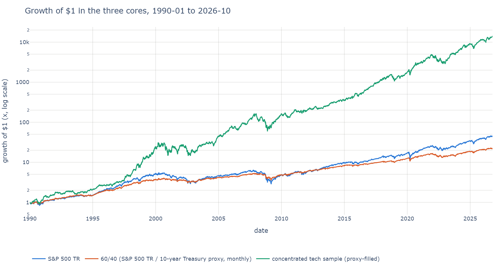

**Table t01_cores: the three cores.**

vol_tax = arithmetic mean - geometric mean of the full calendar years; vol_tax_approx = their variance / 2.

| core | start | end | years | cagr | arith_mean | vol_tax | vol_tax_approx | ann_vol | max_dd | worst_year | tuw | downside_beta |
|---|---|---|---|---|---|---|---|---|---|---|---|---|
| spx | 1990-01-02 | 2026-10-09 | 36.8 | 10.93% | 12.71% | 1.49% | 1.47% | 17.96% | -55.25% | -37.00% | 89.42% | 1 |
| 6040 | 1990-01-02 | 2026-10-09 | 36.8 | 8.80% | 9.61% | 0.56% | 0.59% | 10.49% | -32.54% | -17.38% | 87.10% | 0.538 |
| tech | 1990-01-02 | 2026-10-09 | 36.8 | 29.62% | 38.01% | 7.85% | 9.81% | 28.35% | -64.23% | -54.76% | 88.03% | 1.16 |

**Table t01b_core_crashes: the cores over each crash window.**

| core | crash:1990 Gulf War | crash:1998 LTCM | crash:2000-02 Dot-com | crash:2007-09 GFC | crash:2010 Flash crash | crash:2011 Debt ceiling | crash:2018 Q4 | crash:2020 COVID | crash:2022 Rates | crash:2025 Tariff shock |
|---|---|---|---|---|---|---|---|---|---|---|
| spx | -19.18% | -18.84% | -47.38% | -55.25% | -15.63% | -18.64% | -19.36% | -33.79% | -24.49% | -18.75% |
| 6040 | -12.29% | -8.29% | -20.93% | -32.28% | -6.66% | -6.09% | -10.42% | -18.45% | -21.16% | -10.54% |
| tech | -24.79% | -19.17% | -53.73% | -51.90% | -23.20% | -9.83% | -30.81% | -27.46% | -37.66% | -24.24% |

The S&P 500 TR compounded at 10.93% a year against an arithmetic mean of 12.71% across full calendar years: a volatility tax of 1.49 points, close to its variance-over-two approximation of 1.47. The 60/40 compounded at 8.80% with a 0.56-point tax and a maximum drawdown of -32.54%, against -55.25% for the S&P 500. The tech sample compounded at 29.62% with a 7.85-point tax, a -64.23% drawdown and a downside beta of 1.16 to the S&P 500. The crash table shows the hedging problem in one line: the S&P 500 lost -55.25% in the 2007-09 window and -33.79% in the 2020 COVID window, and the 60/40 lost -21.16% in 2022, when its bonds fell with its stocks. Underwater charts: [S&P 500](figures/cs_02_underwater_spx.png), [60/40](figures/cs_02_underwater_6040.png), [tech](figures/cs_02_underwater_tech.png).

### 2. Candidates and their samples

Table t02 (in the setup) lists every (core, candidate) sample. The model-priced sleeves, PPUT, T-bills, the 10-year proxy and trend cover the full 36.8 years; the other Cboe indices and the ETFs start later, from 2002-07-30 for TLT and IEF to 2019-05-08 for DBMF. TAIL (9.51 years) and DBMF (7.42 years) are reported as "insufficient history" on every core, whatever their frontier says: DBMF's 60/40 frontier peaks at w* 55.00% (+58 bp) on 7.42 years that hold three crash windows. Every candidate stays in every table that applies to it; nothing is dropped for losing.

### 3. Frontiers and the cost-effectiveness plane

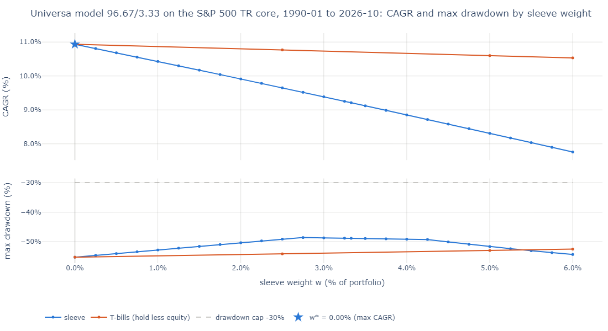

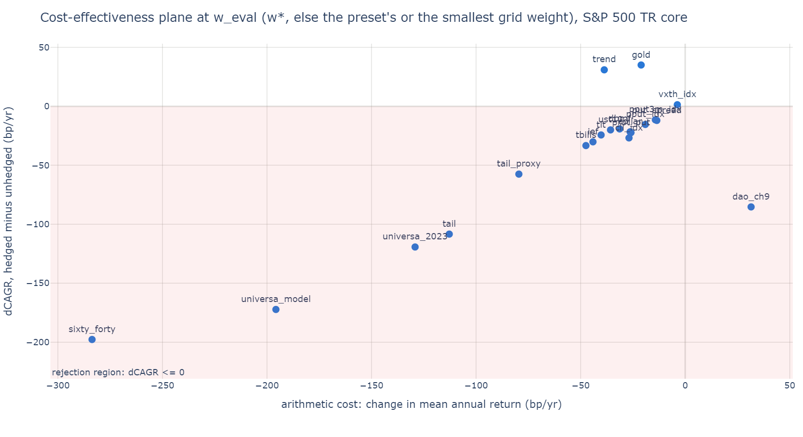

<details>
<summary>Table t03_frontiers: frontiers at w* (and w_cap under the 30% drawdown cap) (click to expand)</summary>

| core | candidate | archetype | years | w_star | w_cap | cagr_unhedged | cagr_star | d_cagr_bp | arith_cost_bp | vol_tax_saved_bp | maxdd_unhedged | maxdd_star | d_cagr_p50_bp | verdict | robustness |
|---|---|---|---|---|---|---|---|---|---|---|---|---|---|---|---|
| spx | universa_model | insurance | 36.8 | 0.00% | n/a | 10.93% | 10.93% | +0 | +0 | +0 | -55.25% | -55.25% | +0 | not cost-effective | not run |
| spx | universa_2023 | insurance | 36.8 | 0.00% | n/a | 10.93% | 10.93% | +0 | +0 | +0 | -55.25% | -55.25% | +0 | not cost-effective | not run |
| spx | dao_ch9 | insurance | 36.8 | 0.00% | n/a | 10.93% | 10.93% | +0 | +0 | +0 | -55.25% | -55.25% | +0 | not cost-effective | not run |
| spx | put_spread | insurance | 36.8 | 0.00% | n/a | 10.93% | 10.93% | +0 | +0 | +0 | -55.25% | -55.25% | +0 | not cost-effective | not run |
| spx | prot_put | insurance | 36.8 | 0.00% | n/a | 10.93% | 10.93% | +0 | +0 | +0 | -55.25% | -55.25% | +0 | not cost-effective | not run |
| spx | collar | insurance | 36.8 | 0.00% | n/a | 10.93% | 10.93% | +0 | +0 | +0 | -55.25% | -55.25% | +0 | not cost-effective | not run |
| spx | pput_idx | insurance | 36.8 | 0.00% | n/a | 10.93% | 10.93% | +0 | +0 | +0 | -55.25% | -55.25% | +0 | not cost-effective | not run |
| spx | pput3m_idx | insurance | 22.6 | 0.00% | n/a | 11.12% | 11.12% | +0 | +0 | +0 | -55.25% | -55.25% | +0 | not cost-effective | not run |
| spx | cll_idx | insurance | 17 | 0.00% | 25.00% | 14.40% | 14.40% | +0 | +0 | +0 | -33.79% | -33.79% | +0 | not cost-effective | not run |
| spx | vxth_idx | insurance | 20.5 | 10.00% | n/a | 11.24% | 11.26% | +1 | -4 | +5 | -55.25% | -54.04% | +1 | cost-effective (fragile) | rolling10 pass, since2015 fail, ex_best_crash_year fail, crash_edge_-10% pass, crash_edge_-20% pass |
| spx | tail | insurance | 9.51 | 0.00% | 10.00% | 15.29% | 15.29% | +0 | +0 | +0 | -33.79% | -33.79% | +0 | insufficient history | not run |
| spx | tail_proxy | insurance | 36.8 | 0.00% | 25.00% | 10.93% | 10.93% | +0 | +0 | +0 | -55.25% | -55.25% | +0 | not cost-effective | not run |
| spx | tbills | store_of_value | 36.8 | 0.00% | 50.00% | 10.93% | 10.93% | +0 | +0 | +0 | -55.25% | -55.25% | +0 | not cost-effective | not run |
| spx | ust10 | store_of_value | 36.8 | 0.00% | 40.00% | 10.93% | 10.93% | +0 | +0 | +0 | -55.25% | -55.25% | +0 | not cost-effective | not run |
| spx | tlt | store_of_value | 24.2 | 0.00% | 40.00% | 11.41% | 11.41% | +0 | +0 | +0 | -55.25% | -55.25% | +0 | not cost-effective | not run |
| spx | ief | store_of_value | 24.2 | 0.00% | 40.00% | 11.41% | 11.41% | +0 | +0 | +0 | -55.25% | -55.25% | +0 | not cost-effective | not run |
| spx | gold | insurance | 21.9 | 35.00% | 75.00% | 11.09% | 11.44% | +35 | -21 | +54 | -55.25% | -35.89% | +69 | cost-effective (fragile) | rolling10 fail, since2015 fail, ex_best_crash_year fail, crash_edge_-10% pass, crash_edge_-20% pass |
| spx | trend | alpha | 36.8 | 75.00% | n/a | 10.93% | 11.24% | +31 | -39 | +69 | -55.25% | -33.79% | -13 | not cost-effective | not run |
| spx | dbmf | alpha | 7.42 | 0.00% | 15.00% | 16.17% | 16.17% | +0 | +0 | +0 | -33.79% | -33.79% | +0 | insufficient history | not run |
| spx | sixty_forty | baseline | 36.8 | 0.00% | n/a | 10.93% | 10.93% | +0 | +0 | +0 | -55.25% | -55.25% | +0 | not cost-effective | not run |
| 6040 | universa_model | insurance | 36.8 | 0.00% | 1.00% | 8.80% | 8.80% | +0 | +0 | +0 | -32.54% | -32.54% | +0 | not cost-effective | not run |
| 6040 | universa_2023 | insurance | 36.8 | 0.00% | n/a | 8.80% | 8.80% | +0 | +0 | +0 | -32.54% | -32.54% | +0 | not cost-effective | not run |
| 6040 | dao_ch9 | insurance | 36.8 | 0.00% | 0.25% | 8.80% | 8.80% | +0 | +0 | +0 | -32.54% | -32.54% | +0 | not cost-effective | not run |
| 6040 | put_spread | insurance | 36.8 | 0.00% | 2.75% | 8.80% | 8.80% | +0 | +0 | +0 | -32.54% | -32.54% | +0 | not cost-effective | not run |
| 6040 | prot_put | insurance | 36.8 | 0.00% | 30.00% | 8.80% | 8.80% | +0 | +0 | +0 | -32.54% | -32.54% | +0 | not cost-effective | not run |
| 6040 | collar | insurance | 36.8 | 0.00% | 20.00% | 8.80% | 8.80% | +0 | +0 | +0 | -32.54% | -32.54% | +0 | not cost-effective | not run |
| 6040 | pput_idx | insurance | 36.8 | 0.00% | n/a | 8.80% | 8.80% | +0 | +0 | +0 | -32.54% | -32.54% | +0 | not cost-effective | not run |
| 6040 | pput3m_idx | insurance | 22.6 | 100.00% | n/a | 7.95% | 8.68% | +73 | +113 | -41 | -32.54% | -39.86% | +53 | cost-effective (robust) | rolling10 pass, since2015 pass, ex_best_crash_year pass, crash_edge_-10% pass, crash_edge_-20% pass |
| 6040 | cll_idx | insurance | 17 | 0.00% | 0.00% | 9.53% | 9.53% | +0 | +0 | +0 | -21.66% | -21.66% | +0 | not cost-effective | not run |
| 6040 | vxth_idx | insurance | 20.5 | 100.00% | n/a | 8.15% | 9.94% | +179 | +360 | -185 | -32.54% | -43.30% | +160 | cost-effective (fragile) | rolling10 pass, since2015 pass, ex_best_crash_year fail, crash_edge_-10% pass, crash_edge_-20% pass |
| 6040 | tail | insurance | 9.51 | 0.00% | 0.00% | 9.40% | 9.40% | +0 | +0 | +0 | -21.66% | -21.66% | +0 | insufficient history | not run |
| 6040 | tail_proxy | insurance | 36.8 | 0.00% | 5.00% | 8.80% | 8.80% | +0 | +0 | +0 | -32.54% | -32.54% | +0 | not cost-effective | not run |
| 6040 | tbills | store_of_value | 36.8 | 0.00% | 10.00% | 8.80% | 8.80% | +0 | +0 | +0 | -32.54% | -32.54% | +0 | not cost-effective | not run |
| 6040 | ust10 | store_of_value | 36.8 | 0.00% | 10.00% | 8.80% | 8.80% | +0 | +0 | +0 | -32.54% | -32.54% | +0 | not cost-effective | not run |
| 6040 | tlt | store_of_value | 24.2 | 0.00% | 10.00% | 8.30% | 8.30% | +0 | +0 | +0 | -32.54% | -32.54% | +0 | not cost-effective | not run |
| 6040 | ief | store_of_value | 24.2 | 0.00% | 10.00% | 8.30% | 8.30% | +0 | +0 | +0 | -32.54% | -32.54% | +0 | not cost-effective | not run |
| 6040 | gold | insurance | 21.9 | 100.00% | 75.00% | 7.97% | 10.37% | +240 | +324 | -97 | -32.54% | -45.56% | +315 | cost-effective (fragile) | rolling10 fail, since2015 pass, ex_best_crash_year pass, crash_edge_-10% pass, crash_edge_-20% pass |
| 6040 | trend | alpha | 36.8 | 100.00% | 75.00% | 8.80% | 11.22% | +242 | +250 | -10 | -32.54% | -33.79% | +204 | cost-effective (robust) | rolling10 pass, since2015 pass, ex_best_crash_year pass, crash_edge_-10% pass, crash_edge_-20% pass |
| 6040 | dbmf | alpha | 7.42 | 55.00% | 55.00% | 9.72% | 10.30% | +58 | +2 | +51 | -21.66% | -13.29% | -42 | insufficient history | not run |
| 6040 | sixty_forty | baseline | 36.8 | 0.00% | 40.00% | 8.80% | 8.80% | +0 | +0 | +0 | -32.54% | -32.54% | +0 | not cost-effective | not run |
| tech | universa_model | insurance | 36.8 | 0.00% | n/a | 29.62% | 29.62% | +0 | +0 | +0 | -64.23% | -64.23% | +0 | not cost-effective | not run |
| tech | universa_2023 | insurance | 36.8 | 0.00% | n/a | 29.62% | 29.62% | +0 | +0 | +0 | -64.23% | -64.23% | +0 | not cost-effective | not run |
| tech | dao_ch9 | insurance | 36.8 | 0.00% | n/a | 29.62% | 29.62% | +0 | +0 | +0 | -64.23% | -64.23% | +0 | not cost-effective | not run |
| tech | put_spread | insurance | 36.8 | 0.00% | n/a | 29.62% | 29.62% | +0 | +0 | +0 | -64.23% | -64.23% | +0 | not cost-effective | not run |
| tech | prot_put | insurance | 36.8 | 0.00% | n/a | 29.62% | 29.62% | +0 | +0 | +0 | -64.23% | -64.23% | +0 | not cost-effective | not run |
| tech | collar | insurance | 36.8 | 0.00% | n/a | 29.62% | 29.62% | +0 | +0 | +0 | -64.23% | -64.23% | +0 | not cost-effective | not run |
| tech | pput_idx | insurance | 36.8 | 0.00% | n/a | 29.62% | 29.62% | +0 | +0 | +0 | -64.23% | -64.23% | +0 | not cost-effective | not run |
| tech | pput3m_idx | insurance | 22.6 | 0.00% | n/a | 31.41% | 31.41% | +0 | +0 | +0 | -64.23% | -64.23% | +0 | not cost-effective | not run |
| tech | cll_idx | insurance | 17 | 0.00% | 50.00% | 31.57% | 31.57% | +0 | +0 | +0 | -41.38% | -41.38% | +0 | not cost-effective | not run |
| tech | vxth_idx | insurance | 20.5 | 0.00% | n/a | 28.97% | 28.97% | +0 | +0 | +0 | -64.23% | -64.23% | +0 | not cost-effective | not run |
| tech | tail | insurance | 9.51 | 0.00% | 45.00% | 34.89% | 34.89% | +0 | +0 | +0 | -41.38% | -41.38% | +0 | insufficient history | not run |
| tech | tail_proxy | insurance | 36.8 | 0.00% | 50.00% | 29.62% | 29.62% | +0 | +0 | +0 | -64.23% | -64.23% | +0 | not cost-effective | not run |
| tech | tbills | store_of_value | 36.8 | 0.00% | 55.00% | 29.62% | 29.62% | +0 | +0 | +0 | -64.23% | -64.23% | +0 | not cost-effective | not run |
| tech | ust10 | store_of_value | 36.8 | 0.00% | 55.00% | 29.62% | 29.62% | +0 | +0 | +0 | -64.23% | -64.23% | +0 | not cost-effective | not run |
| tech | tlt | store_of_value | 24.2 | 0.00% | n/a | 31.72% | 31.72% | +0 | +0 | +0 | -64.23% | -64.23% | +0 | not cost-effective | not run |
| tech | ief | store_of_value | 24.2 | 0.00% | 50.00% | 31.72% | 31.72% | +0 | +0 | +0 | -64.23% | -64.23% | +0 | not cost-effective | not run |
| tech | gold | insurance | 21.9 | 0.00% | 85.00% | 30.64% | 30.64% | +0 | +0 | +0 | -64.23% | -64.23% | +0 | not cost-effective | not run |
| tech | trend | alpha | 36.8 | 0.00% | n/a | 29.62% | 29.62% | +0 | +0 | +0 | -64.23% | -64.23% | +0 | not cost-effective | not run |
| tech | dbmf | alpha | 7.42 | 0.00% | 20.00% | 36.00% | 36.00% | +0 | +0 | +0 | -41.38% | -41.38% | +0 | insufficient history | not run |
| tech | sixty_forty | baseline | 36.8 | 0.00% | n/a | 29.62% | 29.62% | +0 | +0 | +0 | -64.23% | -64.23% | +0 | not cost-effective | not run |

</details>

<details>
<summary>Table t03c_ce_plane: the cost-effectiveness plane at w_eval: arithmetic cost, volatility tax saved, dCAGR (click to expand)</summary>

| core | candidate | verdict | w_eval | arith_cost_bp | vol_tax_saved_bp | d_cagr_bp |
|---|---|---|---|---|---|---|
| spx | universa_model | not cost-effective | 3.33% | -196 | +25 | -172 |
| spx | universa_2023 | not cost-effective | 2.00% | -129 | +11 | -119 |
| spx | dao_ch9 | not cost-effective | 0.50% | +32 | -116 | -85 |
| spx | put_spread | not cost-effective | 0.25% | -14 | +2 | -12 |
| spx | prot_put | not cost-effective | 5.00% | -26 | +4 | -22 |
| spx | collar | not cost-effective | 5.00% | -26 | +5 | -22 |
| spx | pput_idx | not cost-effective | 5.00% | -19 | +4 | -15 |
| spx | pput3m_idx | not cost-effective | 5.00% | -14 | +3 | -11 |
| spx | cll_idx | not cost-effective | 5.00% | -27 | +2 | -27 |
| spx | vxth_idx | cost-effective (fragile) | 10.00% | -4 | +5 | +1 |
| spx | tail | insufficient history | 5.00% | -113 | +10 | -108 |
| spx | tail_proxy | not cost-effective | 5.00% | -80 | +22 | -58 |
| spx | tbills | not cost-effective | 5.00% | -47 | +14 | -33 |
| spx | ust10 | not cost-effective | 5.00% | -36 | +16 | -20 |
| spx | tlt | not cost-effective | 5.00% | -40 | +17 | -24 |
| spx | ief | not cost-effective | 5.00% | -44 | +15 | -30 |
| spx | gold | cost-effective (fragile) | 35.00% | -21 | +54 | +35 |
| spx | trend | not cost-effective | 75.00% | -39 | +69 | +31 |
| spx | dbmf | insufficient history | 5.00% | -31 | +14 | -19 |
| spx | sixty_forty | not cost-effective | 40.00% | -284 | +87 | -198 |
| 6040 | universa_model | not cost-effective | 3.33% | -186 | +8 | -179 |
| 6040 | universa_2023 | not cost-effective | 2.00% | -122 | +4 | -119 |
| 6040 | dao_ch9 | not cost-effective | 0.50% | -20 | -110 | -131 |
| 6040 | put_spread | not cost-effective | 0.25% | -13 | +1 | -12 |
| 6040 | prot_put | not cost-effective | 5.00% | -14 | +1 | -13 |
| 6040 | collar | not cost-effective | 5.00% | -14 | +1 | -13 |
| 6040 | pput_idx | not cost-effective | 5.00% | -4 | -1 | -5 |
| 6040 | pput3m_idx | cost-effective (robust) | 100.00% | +113 | -41 | +73 |
| 6040 | cll_idx | not cost-effective | 5.00% | -2 | +0 | -2 |
| 6040 | vxth_idx | cost-effective (fragile) | 100.00% | +360 | -185 | +179 |
| 6040 | tail | insufficient history | 5.00% | -83 | +5 | -82 |
| 6040 | tail_proxy | not cost-effective | 5.00% | -64 | +8 | -57 |
| 6040 | tbills | not cost-effective | 5.00% | -32 | +5 | -27 |
| 6040 | ust10 | not cost-effective | 5.00% | -21 | +4 | -16 |
| 6040 | tlt | not cost-effective | 5.00% | -21 | +4 | -18 |
| 6040 | ief | not cost-effective | 5.00% | -25 | +4 | -22 |
| 6040 | gold | cost-effective (fragile) | 100.00% | +324 | -97 | +240 |
| 6040 | trend | cost-effective (robust) | 100.00% | +250 | -10 | +242 |
| 6040 | dbmf | insufficient history | 55.00% | +2 | +51 | +58 |
| 6040 | sixty_forty | not cost-effective | 40.00% | -163 | +23 | -141 |
| tech | universa_model | not cost-effective | 3.33% | -278 | +75 | -204 |
| tech | universa_2023 | not cost-effective | 2.00% | -204 | +39 | -167 |
| tech | dao_ch9 | not cost-effective | 0.50% | +75 | -190 | -117 |
| tech | put_spread | not cost-effective | 0.25% | -20 | +5 | -15 |
| tech | prot_put | not cost-effective | 5.00% | -40 | +10 | -31 |
| tech | collar | not cost-effective | 5.00% | -41 | +12 | -29 |
| tech | pput_idx | not cost-effective | 5.00% | -142 | +53 | -89 |
| tech | pput3m_idx | not cost-effective | 5.00% | -140 | +46 | -96 |
| tech | cll_idx | not cost-effective | 5.00% | -121 | +24 | -105 |
| tech | vxth_idx | not cost-effective | 5.00% | -116 | +45 | -74 |
| tech | tail | insufficient history | 5.00% | -228 | +51 | -189 |
| tech | tail_proxy | not cost-effective | 5.00% | -202 | +88 | -115 |
| tech | tbills | not cost-effective | 5.00% | -170 | +72 | -100 |
| tech | ust10 | not cost-effective | 5.00% | -159 | +77 | -82 |
| tech | tlt | not cost-effective | 5.00% | -164 | +71 | -96 |
| tech | ief | not cost-effective | 5.00% | -167 | +68 | -104 |
| tech | gold | not cost-effective | 5.00% | -122 | +61 | -65 |
| tech | trend | not cost-effective | 5.00% | -125 | +60 | -66 |
| tech | dbmf | insufficient history | 5.00% | -148 | +76 | -79 |
| tech | sixty_forty | not cost-effective | 40.00% | -1267 | +471 | -802 |

</details>

<details>
<summary>Table t03b_sleeve_scores: sleeve scores at w_scores (w*, or the smallest grid weight), portfolio points (click to expand)</summary>

| core | candidate | w_scores | calm_year_bleed | crash_payoff_mean | crash_payoff_fast | crash_payoff_slow | avg_premium_yr | avg_coverage | attr_crash_bp | attr_noncrash_bp | shock20_pnl |
|---|---|---|---|---|---|---|---|---|---|---|---|
| spx | universa_model | 0.25% | -0.18% | 0.41% | 0.52% | 0.16% | 0.17% | 102.84% | +2 | -16 | -12.20% |
| spx | universa_2023 | 2.00% | -1.46% | 3.12% | 4.28% | 0.43% | 1.43% | 740.85% | +3 | -134 | -15.58% |
| spx | dao_ch9 | 0.25% | 0.00% | 6.21% | 7.98% | 2.08% | 3.00% | 896.95% | +25 | +0 | -15.20% |
| spx | put_spread | 0.25% | -0.16% | 0.18% | 0.19% | 0.15% | 0.17% | 4.35% | +1 | -15 | -15.32% |
| spx | prot_put | 5.00% | -0.31% | 0.38% | 0.40% | 0.35% | 0.46% | 4.95% | +2 | -28 | -19.29% |
| spx | collar | 5.00% | -0.34% | 0.61% | 0.63% | 0.57% | 0.37% | 4.90% | +4 | -31 | -19.28% |
| spx | pput_idx | 5.00% | -0.24% | 0.40% | 0.38% | 0.44% | n/a | 4.94% | +3 | -22 | n/a |
| spx | pput3m_idx | 5.00% | -0.19% | 0.34% | 0.29% | 0.49% | n/a | 4.95% | +3 | -17 | n/a |
| spx | cll_idx | 5.00% | -0.32% | 0.40% | 0.41% | 0.37% | n/a | 4.90% | +1 | -30 | n/a |
| spx | vxth_idx | 10.00% | -0.03% | 1.39% | 1.79% | 0.37% | n/a | 10.09% | +5 | -3 | n/a |
| spx | tail | 5.00% | -1.27% | 1.98% | 2.30% | 1.01% | n/a | 4.61% | +3 | -111 | n/a |
| spx | tail_proxy | 5.00% | -1.11% | 2.37% | 2.04% | 3.14% | 0.57% | 9.38% | +20 | -101 | -17.56% |
| spx | tbills | 5.00% | -0.68% | 1.27% | 0.99% | 1.94% | n/a | 4.88% | +12 | -62 | n/a |
| spx | ust10 | 5.00% | -0.55% | 1.54% | 1.26% | 2.18% | n/a | 4.91% | +14 | -51 | n/a |
| spx | tlt | 5.00% | -0.59% | 1.60% | 1.64% | 1.48% | n/a | 4.88% | +13 | -54 | n/a |
| spx | ief | 5.00% | -0.64% | 1.41% | 1.32% | 1.66% | n/a | 4.89% | +13 | -58 | n/a |
| spx | gold | 35.00% | -0.94% | 9.91% | 8.22% | 14.13% | n/a | 35.44% | +99 | -85 | n/a |
| spx | trend | 75.00% | -2.07% | 8.12% | 2.25% | 21.82% | n/a | 74.94% | +121 | -189 | n/a |
| spx | dbmf | 5.00% | -0.91% | 1.58% | 0.97% | 2.81% | n/a | 5.10% | +33 | -76 | n/a |
| spx | sixty_forty | 40.00% | -4.31% | 11.61% | 8.82% | 18.10% | n/a | 39.40% | +100 | -394 | n/a |
| 6040 | universa_model | 0.25% | -0.17% | 0.40% | 0.52% | 0.13% | 0.17% | 104.48% | +1 | -15 | -12.20% |
| 6040 | universa_2023 | 2.00% | -1.37% | 2.91% | 4.11% | 0.11% | 1.43% | 745.07% | +1 | -125 | -15.58% |
| 6040 | dao_ch9 | 0.25% | -0.35% | 6.56% | 8.22% | 2.68% | 3.00% | 897.52% | +30 | -32 | -15.20% |
| 6040 | put_spread | 0.25% | -0.15% | 0.16% | 0.18% | 0.13% | 0.17% | 4.42% | +1 | -14 | -15.32% |
| 6040 | prot_put | 5.00% | -0.17% | 0.22% | 0.22% | 0.22% | 0.25% | 2.68% | +1 | -15 | -19.29% |
| 6040 | collar | 5.00% | -0.19% | 0.36% | 0.35% | 0.39% | 0.20% | 2.66% | +2 | -17 | -19.28% |
| 6040 | pput_idx | 5.00% | -0.01% | -0.22% | -0.12% | -0.44% | n/a | 4.98% | -2 | -1 | n/a |
| 6040 | pput3m_idx | 100.00% | 1.49% | -4.37% | -5.02% | -2.77% | n/a | 100.00% | -38 | +135 | n/a |
| 6040 | cll_idx | 5.00% | -0.05% | -0.07% | -0.12% | 0.21% | n/a | 4.97% | +1 | -5 | n/a |
| 6040 | vxth_idx | 100.00% | 5.19% | 2.45% | 7.24% | -9.53% | n/a | 100.00% | -57 | +465 | n/a |
| 6040 | tail | 5.00% | -0.93% | 1.59% | 1.84% | 0.85% | n/a | 4.68% | +2 | -82 | n/a |
| 6040 | tail_proxy | 5.00% | -0.88% | 1.99% | 1.63% | 2.83% | 0.57% | 9.47% | +15 | -81 | -17.56% |
| 6040 | tbills | 5.00% | -0.45% | 0.77% | 0.53% | 1.35% | n/a | 4.90% | +7 | -41 | n/a |
| 6040 | ust10 | 5.00% | -0.33% | 1.07% | 0.81% | 1.69% | n/a | 4.93% | +9 | -30 | n/a |
| 6040 | tlt | 5.00% | -0.32% | 1.14% | 1.16% | 1.08% | n/a | 4.91% | +8 | -29 | n/a |
| 6040 | ief | 5.00% | -0.37% | 0.95% | 0.82% | 1.26% | n/a | 4.92% | +8 | -34 | n/a |
| 6040 | gold | 100.00% | 2.56% | 19.36% | 13.10% | 35.01% | n/a | 100.00% | +184 | +231 | n/a |
| 6040 | trend | 100.00% | 1.73% | -1.32% | -7.21% | 12.42% | n/a | 100.00% | +62 | +158 | n/a |
| 6040 | dbmf | 55.00% | -5.52% | 12.50% | 4.19% | 29.10% | n/a | 55.62% | +355 | -460 | n/a |
| 6040 | sixty_forty | 40.00% | -2.52% | 7.41% | 5.01% | 13.02% | n/a | 39.59% | +60 | -230 | n/a |
| tech | universa_model | 0.25% | -0.25% | 0.41% | 0.46% | 0.28% | 0.16% | 97.81% | +2 | -23 | -12.20% |
| tech | universa_2023 | 2.00% | -2.33% | 3.02% | 4.00% | 0.74% | 1.41% | 724.41% | +5 | -213 | -15.58% |
| tech | dao_ch9 | 0.25% | 0.35% | 6.29% | 7.96% | 2.40% | 3.00% | 891.32% | +18 | +32 | -15.20% |
| tech | put_spread | 0.25% | -0.23% | 0.18% | 0.18% | 0.19% | 0.16% | 4.11% | +1 | -21 | -15.32% |
| tech | prot_put | 5.00% | -0.47% | 0.45% | 0.46% | 0.41% | 0.54% | 5.72% | +2 | -43 | -19.29% |
| tech | collar | 5.00% | -0.50% | 0.70% | 0.72% | 0.67% | 0.43% | 5.57% | +4 | -46 | -19.28% |
| tech | pput_idx | 5.00% | -1.69% | 0.63% | 0.46% | 1.02% | n/a | 4.63% | +9 | -155 | n/a |
| tech | pput3m_idx | 5.00% | -1.68% | 0.52% | 0.35% | 0.96% | n/a | 4.66% | +12 | -152 | n/a |
| tech | cll_idx | 5.00% | -1.43% | 0.55% | 0.46% | 1.02% | n/a | 4.61% | +7 | -134 | n/a |
| tech | vxth_idx | 5.00% | -1.48% | 0.87% | 0.92% | 0.73% | n/a | 4.75% | +12 | -133 | n/a |
| tech | tail | 5.00% | -2.84% | 2.09% | 2.24% | 1.65% | n/a | 4.25% | +15 | -249 | n/a |
| tech | tail_proxy | 5.00% | -2.56% | 2.58% | 1.93% | 4.12% | 0.54% | 8.82% | +26 | -234 | -17.56% |
| tech | tbills | 5.00% | -2.14% | 1.47% | 0.98% | 2.62% | n/a | 4.59% | +18 | -195 | n/a |
| tech | ust10 | 5.00% | -2.01% | 1.76% | 1.24% | 3.00% | n/a | 4.62% | +20 | -184 | n/a |
| tech | tlt | 5.00% | -2.13% | 1.87% | 1.66% | 2.40% | n/a | 4.61% | +21 | -195 | n/a |
| tech | ief | 5.00% | -2.18% | 1.65% | 1.34% | 2.43% | n/a | 4.62% | +21 | -199 | n/a |
| tech | gold | 5.00% | -1.63% | 1.55% | 1.20% | 2.45% | n/a | 4.84% | +23 | -147 | n/a |
| tech | trend | 5.00% | -1.59% | 0.75% | 0.23% | 1.95% | n/a | 4.69% | +15 | -146 | n/a |
| tech | dbmf | 5.00% | -2.81% | 1.75% | 0.90% | 3.45% | n/a | 4.81% | +49 | -234 | n/a |
| tech | sixty_forty | 40.00% | -15.97% | 13.22% | 8.91% | 23.26% | n/a | 37.58% | +153 | -1460 | n/a |

</details>

On the S&P 500 core every option sleeve's CAGR falls from the first grid step: at 3.33% the Universa sleeve gives up 196 bp of arithmetic return to save 25 bp of volatility tax, a dCAGR of -172 bp (table t03c). The real put indices say the same with real prices: PPUT at 5.00% costs 19 bp of arithmetic return for 4 bp of tax saved (-15 bp). The Dao preset fails differently: at 0.50% it raises the arithmetic mean (+32 bp) but its volatility tax rises by 116 bp, because its payoff is a lottery concentrated in one quarter (+90.16% for the hedged portfolio in Q1 2020, table t10), which adds variance instead of removing it. Gold (54 bp of tax saved for 21 bp of return at 35.00%) and trend (69 bp for 39 bp at 75.00%) are the only candidates above the line on this core. No option preset meets the 30% drawdown cap on the S&P 500 core (w_cap n/a in table t03), while T-bills, Treasuries, gold, the TAIL proxy and CLL do at weights of 25.00% to 75.00%.

The frontier chart of every candidate on every core (with the T-bill frontier, the cap and w*) and the planes at w* are listed in the [figure index](#figure-index).

### 4. The AQR tests: hold less equity instead

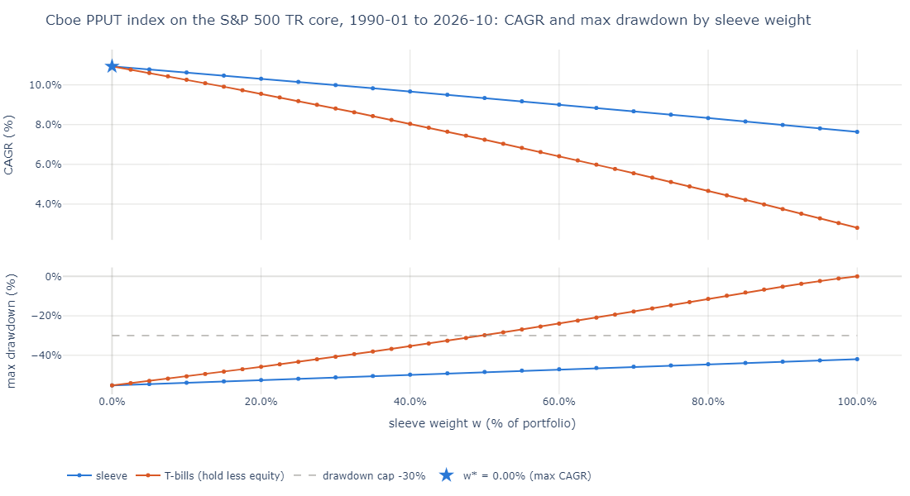

<details>
<summary>Table t04_aqr: the AQR tests: hold less equity at equal drawdown or equal CAGR; the critic's view (click to expand)</summary>

| core | candidate | w_star | w_cap | w_twin | d_cagr_vs_dd_matched_cash_bp | w_cash_twin | maxdd_cash_twin | dd_gap_vs_cagr_matched_cash | beats_deleverage | critic_sleeve_cagr | critic_sleeve_sharpe | critic_alpha | critic_beta |
|---|---|---|---|---|---|---|---|---|---|---|---|---|---|
| spx | universa_model | 0.00% | n/a | 0.00% | +0 | 0.00% | -55.25% | 0.00% | no | -59.72% | -0.209 | 9.57% | -4.03 |
| spx | universa_2023 | 0.00% | n/a | 0.00% | +0 | 0.00% | -55.25% | 0.00% | no | -43.90% | -0.205 | 6.75% | -3.01 |
| spx | dao_ch9 | 0.00% | n/a | 0.00% | +0 | 0.00% | -55.25% | 0.00% | no | -100.00% | 0.157 | 4752.01% | -42.2 |
| spx | put_spread | 0.00% | n/a | 0.00% | +0 | 0.00% | -55.25% | 0.00% | no | -49.18% | -0.914 | -31.01% | -2.47 |
| spx | prot_put | 0.00% | n/a | 0.00% | +0 | 0.00% | -55.25% | 0.00% | no | 6.20% | 0.316 | -1.91% | 0.65 |
| spx | collar | 0.00% | n/a | 0.00% | +0 | 0.00% | -55.25% | 0.00% | no | 6.05% | 0.349 | -0.67% | 0.467 |
| spx | pput_idx | 0.00% | n/a | 0.00% | +0 | 0.00% | -55.25% | 0.00% | no | 7.64% | 0.41 | -0.76% | 0.677 |
| spx | pput3m_idx | 0.00% | n/a | 0.00% | +0 | 0.00% | -55.25% | 0.00% | no | 8.68% | 0.548 | 0.86% | 0.629 |
| spx | cll_idx | 0.00% | 25.00% | 25.00% | +42 | 11.02% | -30.21% | 1.12% | yes | 8.92% | 0.669 | 0.08% | 0.57 |
| spx | vxth_idx | 10.00% | n/a | 10.00% | +22 | n/a | n/a | n/a | yes | 9.94% | 0.556 | 1.98% | 0.66 |
| spx | tail | 0.00% | 10.00% | 10.00% | +0 | 18.41% | -27.80% | 0.00% | yes | -7.72% | -0.654 | -1.28% | -0.619 |
| spx | tail_proxy | 0.00% | 25.00% | 25.00% | +57 | 42.92% | -33.78% | 4.00% | yes | -4.40% | -0.385 | 0.78% | -0.74 |
| spx | tbills | 0.00% | 50.00% | 50.00% | +0 | 50.00% | -29.79% | 0.00% | no | 2.81% | n/a | 0.00% | 0 |
| spx | ust10 | 0.00% | 40.00% | 40.00% | +179 | 27.69% | -41.92% | 12.44% | yes | 4.79% | 0.294 | 2.85% | -0.0741 |
| spx | tlt | 0.00% | 40.00% | 40.00% | +235 | 28.83% | -41.33% | 13.68% | yes | 3.32% | 0.178 | 5.05% | -0.232 |
| spx | ief | 0.00% | 40.00% | 40.00% | +173 | 31.66% | -39.86% | 10.07% | yes | 3.38% | 0.266 | 2.97% | -0.107 |
| spx | gold | 35.00% | 75.00% | 75.00% | +420 | 0.43% | -55.06% | 25.09% | yes | 10.37% | 0.534 | 9.06% | 0.0655 |
| spx | trend | 75.00% | n/a | 75.00% | +343 | n/a | n/a | n/a | yes | 11.22% | 0.636 | 3.31% | 0.599 |
| spx | dbmf | 0.00% | 15.00% | 15.00% | +95 | 5.00% | -32.17% | 2.48% | yes | 9.97% | 0.606 | 5.85% | 0.114 |
| spx | sixty_forty | 0.00% | n/a | 0.00% | +0 | 0.00% | -55.25% | 0.00% | no | 4.99% | 0.382 | 2.26% | -0.00163 |
| 6040 | universa_model | 0.00% | 1.00% | 1.00% | -5 | 9.61% | -29.58% | -0.28% | no | -59.72% | -0.209 | 9.57% | -4.03 |
| 6040 | universa_2023 | 0.00% | n/a | 0.00% | +0 | 0.00% | -32.54% | 0.00% | no | -43.90% | -0.205 | 6.75% | -3.01 |
| 6040 | dao_ch9 | 0.00% | 0.25% | 0.25% | +122 | 7.10% | -30.40% | 6.68% | yes | -100.00% | 0.157 | 4752.01% | -42.2 |
| 6040 | put_spread | 0.00% | 2.75% | 2.75% | -86 | 24.08% | -25.00% | -4.80% | no | -49.18% | -0.914 | -31.01% | -2.47 |
| 6040 | prot_put | 0.00% | 30.00% | 30.00% | -32 | 14.04% | -28.27% | -1.73% | no | 6.11% | 0.432 | -0.01% | 0.38 |
| 6040 | collar | 0.00% | 20.00% | 20.00% | +10 | 9.47% | -29.68% | 0.53% | yes | 6.03% | 0.483 | 0.67% | 0.287 |
| 6040 | pput_idx | 0.00% | n/a | 0.00% | +0 | 0.00% | -32.54% | 0.00% | no | 7.64% | 0.41 | -0.76% | 0.677 |
| 6040 | pput3m_idx | 100.00% | n/a | 100.00% | n/a | n/a | n/a | n/a | no | 8.68% | 0.548 | 0.86% | 0.629 |
| 6040 | cll_idx | 0.00% | 0.00% | 0.00% | +0 | 0.00% | -21.66% | 0.00% | no | 8.92% | 0.669 | 0.08% | 0.57 |
| 6040 | vxth_idx | 100.00% | n/a | 100.00% | n/a | n/a | n/a | n/a | no | 9.94% | 0.556 | 1.98% | 0.66 |
| 6040 | tail | 0.00% | 0.00% | 0.00% | +0 | 0.00% | -21.66% | 0.00% | no | -7.72% | -0.654 | -1.28% | -0.619 |
| 6040 | tail_proxy | 0.00% | 5.00% | 5.00% | +17 | 10.34% | -29.36% | 0.93% | yes | -4.40% | -0.385 | 0.78% | -0.74 |
| 6040 | tbills | 0.00% | 10.00% | 10.00% | +0 | 10.00% | -29.46% | 0.00% | no | 2.81% | n/a | 0.00% | 0 |
| 6040 | ust10 | 0.00% | 10.00% | 10.00% | +42 | 6.07% | -30.68% | 2.38% | yes | 4.79% | 0.294 | 2.85% | -0.0741 |
| 6040 | tlt | 0.00% | 10.00% | 10.00% | +57 | 6.00% | -30.70% | 2.89% | yes | 3.32% | 0.178 | 5.05% | -0.232 |
| 6040 | ief | 0.00% | 10.00% | 10.00% | +39 | 7.12% | -30.36% | 1.99% | yes | 3.38% | 0.266 | 2.97% | -0.107 |
| 6040 | gold | 100.00% | 75.00% | 75.00% | +299 | n/a | n/a | n/a | yes | 10.37% | 0.534 | 9.06% | 0.0655 |
| 6040 | trend | 100.00% | 75.00% | 75.00% | +231 | n/a | n/a | n/a | yes | 11.22% | 0.636 | 3.31% | 0.599 |
| 6040 | dbmf | 55.00% | 55.00% | 55.00% | +296 | n/a | n/a | n/a | yes | 9.97% | 0.606 | 5.85% | 0.114 |
| 6040 | sixty_forty | 0.00% | 40.00% | 40.00% | +93 | 25.13% | -24.66% | 5.27% | yes | 4.99% | 0.382 | 2.26% | -0.00163 |
| tech | universa_model | 0.00% | n/a | 0.00% | +0 | 0.00% | -64.23% | 0.00% | no | -59.72% | -0.209 | 9.57% | -4.03 |
| tech | universa_2023 | 0.00% | n/a | 0.00% | +0 | 0.00% | -64.23% | 0.00% | no | -43.90% | -0.205 | 6.75% | -3.01 |
| tech | dao_ch9 | 0.00% | n/a | 0.00% | +0 | 0.00% | -64.23% | 0.00% | no | -100.00% | 0.157 | 4752.01% | -42.2 |
| tech | put_spread | 0.00% | n/a | 0.00% | +0 | 0.00% | -64.23% | 0.00% | no | -49.18% | -0.914 | -31.01% | -2.47 |
| tech | prot_put | 0.00% | n/a | 0.00% | +0 | 0.00% | -64.23% | 0.00% | no | 23.12% | 0.867 | 13.42% | 0.818 |
| tech | collar | 0.00% | n/a | 0.00% | +0 | 0.00% | -64.23% | 0.00% | no | 22.98% | 0.922 | 14.72% | 0.613 |
| tech | pput_idx | 0.00% | n/a | 0.00% | +0 | 0.00% | -64.23% | 0.00% | no | 7.64% | 0.41 | -0.76% | 0.677 |
| tech | pput3m_idx | 0.00% | n/a | 0.00% | +0 | 0.00% | -64.23% | 0.00% | no | 8.68% | 0.548 | 0.86% | 0.629 |
| tech | cll_idx | 0.00% | 50.00% | 50.00% | -261 | 38.82% | -25.29% | -3.80% | no | 8.92% | 0.669 | 0.08% | 0.57 |
| tech | vxth_idx | 0.00% | n/a | 0.00% | +0 | 0.00% | -64.23% | 0.00% | no | 9.94% | 0.556 | 1.98% | 0.66 |
| tech | tail | 0.00% | 45.00% | 45.00% | -946 | 59.38% | -16.48% | -12.72% | no | -7.72% | -0.654 | -1.28% | -0.619 |
| tech | tail_proxy | 0.00% | 50.00% | 50.00% | -147 | 60.18% | -25.38% | -3.47% | no | -4.40% | -0.385 | 0.78% | -0.74 |
| tech | tbills | 0.00% | 55.00% | 55.00% | +0 | 55.00% | -28.78% | 0.00% | no | 2.81% | n/a | 0.00% | 0 |
| tech | ust10 | 0.00% | 55.00% | 55.00% | +123 | 49.81% | -32.18% | 2.97% | yes | 4.79% | 0.294 | 2.85% | -0.0741 |
| tech | tlt | 0.00% | n/a | 0.00% | +0 | 0.00% | -64.23% | 0.00% | no | 3.32% | 0.178 | 5.05% | -0.232 |
| tech | ief | 0.00% | 50.00% | 50.00% | +207 | 46.68% | -34.22% | 4.50% | yes | 3.38% | 0.266 | 2.97% | -0.107 |
| tech | gold | 0.00% | 85.00% | 85.00% | -263 | 62.08% | -24.12% | -5.78% | no | 10.37% | 0.534 | 9.06% | 0.0655 |
| tech | trend | 0.00% | n/a | 0.00% | +0 | 0.00% | -64.23% | 0.00% | no | 11.22% | 0.636 | 3.31% | 0.599 |
| tech | dbmf | 0.00% | 20.00% | 20.00% | +461 | 12.87% | -36.13% | 6.48% | yes | 9.97% | 0.606 | 5.85% | 0.114 |
| tech | sixty_forty | 0.00% | n/a | 0.00% | +0 | 0.00% | -64.23% | 0.00% | no | 4.99% | 0.382 | 2.26% | -0.00163 |

</details>

AQR's test (Israelov 2019) asks whether a hedge beats simply holding less equity at the same drawdown. On the S&P 500 core no option preset passes: none meets the cap, so the twins are read at w* = 0 and beats_deleverage is "no". The candidates that pass are the statistical havens: at w_cap the 10-year Treasury proxy beats the drawdown-matched T-bill mix by +179 bp a year, TLT by +235 bp, gold by +420 bp, trend by +343 bp, and the TAIL proxy passes at 25.00% (+57 bp), carried by its Treasury bonds. On the 60/40 core the Dao preset passes at 0.25% (+122 bp) and the collar at 20.00% (+10 bp), while the Universa sleeve (-5 bp at 1.00%), the put spread (-86 bp at 2.75%) and the protective put (-32 bp at 30.00%) fail. On their own, the premium sleeves look as bad as the critics say: the Universa sleeve compounds at -59.72% (Sharpe -0.209) and the Dao sleeve, which spends all its capital every month, at -100.00%; the protective put and PPUT keep positive sleeve CAGRs (6.20%, 7.64%) with negative alphas (-1.91%, -0.76%).

### 5. Hold more equity: the relever test

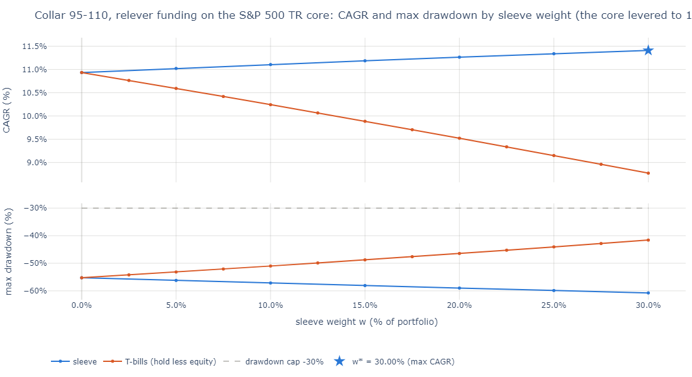

**Table t05_relever: hold more equity: relever (L = 1 / (1 - w)) vs carve-out, option sleeves.**

relever: the core levered to 1 / (1 - w) at rf + 50 bp, so the core stays 100% and the sleeve is financed on top (the overlays prot_put and collar hold the core themselves: 1 + w of equity); grid weights above 1/3 dropped.

| core | candidate | funding | w_star | gross_exposure | cagr_star | d_cagr_bp | maxdd_star | d_cagr_vs_dd_matched_cash_bp | beats_deleverage | verdict |
|---|---|---|---|---|---|---|---|---|---|---|
| spx | universa_model | carve_out | 0.00% | 1 | 10.93% | +0 | -55.25% | +0 | no | not cost-effective |
| spx | universa_model | relever | 0.00% | 1 | 10.93% | +0 | -55.25% | +0 | no | not cost-effective |
| spx | universa_2023 | carve_out | 0.00% | 1 | 10.93% | +0 | -55.25% | +0 | no | not cost-effective |
| spx | universa_2023 | relever | 0.00% | 1 | 10.93% | +0 | -55.25% | +0 | no | not cost-effective |
| spx | dao_ch9 | carve_out | 0.00% | 1 | 10.93% | +0 | -55.25% | +0 | no | not cost-effective |
| spx | dao_ch9 | relever | 0.00% | 1 | 10.93% | +0 | -55.25% | +0 | no | not cost-effective |
| spx | put_spread | carve_out | 0.00% | 1 | 10.93% | +0 | -55.25% | +0 | no | not cost-effective |
| spx | put_spread | relever | 0.00% | 1 | 10.93% | +0 | -55.25% | +0 | no | not cost-effective |
| spx | prot_put | carve_out | 0.00% | 1 | 10.93% | +0 | -55.25% | +0 | no | not cost-effective |
| spx | prot_put | relever | 30.00% | 1.3 | 11.34% | +40 | -63.59% | n/a | no | cost-effective (fragile) |
| spx | collar | carve_out | 0.00% | 1 | 10.93% | +0 | -55.25% | +0 | no | not cost-effective |
| spx | collar | relever | 30.00% | 1.3 | 11.41% | +48 | -60.75% | n/a | no | cost-effective (robust) |
| 6040 | universa_model | carve_out | 0.00% | 1 | 8.80% | +0 | -32.54% | -5 | no | not cost-effective |
| 6040 | universa_model | relever | 0.00% | 1 | 8.80% | +0 | -32.54% | -7 | no | not cost-effective |
| 6040 | universa_2023 | carve_out | 0.00% | 1 | 8.80% | +0 | -32.54% | +0 | no | not cost-effective |
| 6040 | universa_2023 | relever | 0.00% | 1 | 8.80% | +0 | -32.54% | +0 | no | not cost-effective |
| 6040 | dao_ch9 | carve_out | 0.00% | 1 | 8.80% | +0 | -32.54% | +122 | yes | not cost-effective |
| 6040 | dao_ch9 | relever | 0.00% | 1 | 8.80% | +0 | -32.54% | +123 | yes | not cost-effective |
| 6040 | put_spread | carve_out | 0.00% | 1 | 8.80% | +0 | -32.54% | -86 | no | not cost-effective |
| 6040 | put_spread | relever | 0.00% | 1 | 8.80% | +0 | -32.54% | -118 | no | not cost-effective |
| 6040 | prot_put | carve_out | 0.00% | 1 | 8.80% | +0 | -32.54% | -32 | no | not cost-effective |
| 6040 | prot_put | relever | 30.00% | 1.3 | 9.48% | +68 | -38.75% | n/a | no | cost-effective (robust) |
| 6040 | collar | carve_out | 0.00% | 1 | 8.80% | +0 | -32.54% | +10 | yes | not cost-effective |
| 6040 | collar | relever | 30.00% | 1.3 | 9.49% | +69 | -36.40% | n/a | no | cost-effective (robust) |
| tech | universa_model | carve_out | 0.00% | 1 | 29.62% | +0 | -64.23% | +0 | no | not cost-effective |
| tech | universa_model | relever | 0.00% | 1 | 29.62% | +0 | -64.23% | +0 | no | not cost-effective |
| tech | universa_2023 | carve_out | 0.00% | 1 | 29.62% | +0 | -64.23% | +0 | no | not cost-effective |
| tech | universa_2023 | relever | 0.00% | 1 | 29.62% | +0 | -64.23% | +0 | no | not cost-effective |
| tech | dao_ch9 | carve_out | 0.00% | 1 | 29.62% | +0 | -64.23% | +0 | no | not cost-effective |
| tech | dao_ch9 | relever | 0.00% | 1 | 29.62% | +0 | -64.23% | +0 | no | not cost-effective |
| tech | put_spread | carve_out | 0.00% | 1 | 29.62% | +0 | -64.23% | +0 | no | not cost-effective |
| tech | put_spread | relever | 0.00% | 1 | 29.62% | +0 | -64.23% | +0 | no | not cost-effective |
| tech | prot_put | carve_out | 0.00% | 1 | 29.62% | +0 | -64.23% | +0 | no | not cost-effective |
| tech | prot_put | relever | 30.00% | 1.3 | 34.78% | +517 | -71.21% | n/a | no | cost-effective (robust) |
| tech | collar | carve_out | 0.00% | 1 | 29.62% | +0 | -64.23% | +0 | no | not cost-effective |
| tech | collar | relever | 30.00% | 1.3 | 34.95% | +534 | -69.64% | n/a | no | cost-effective (robust) |

Levering the core to 1 / (1 - w) to pay for the hedge does not rescue the premium sleeves: the Universa sleeves, the Dao preset and the put spread keep w* = 0.00% under relever funding on all three cores. The overlays change sign: on the S&P 500 core the protective put reaches +40 bp and the collar +48 bp at 30.00% (gross exposure 1.3), with deeper drawdowns (-63.59% and -60.75%, against -55.25%). Those drawdowns lie outside the T-bill frontier's range, so the drawdown-matched gap is n/a and neither beats deleveraging. The overlay sleeve holds the core itself, so at 30.00% the portfolio holds 1.3 times the equity with puts on the levered part: the gain is leverage at work, as the tech core shows (+517 bp and +534 bp).

### 6. Robustness

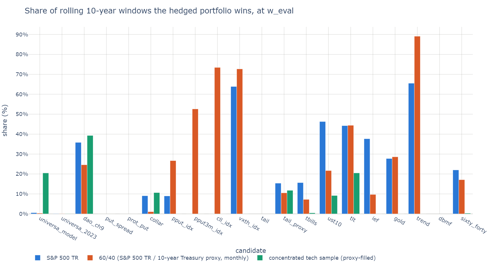

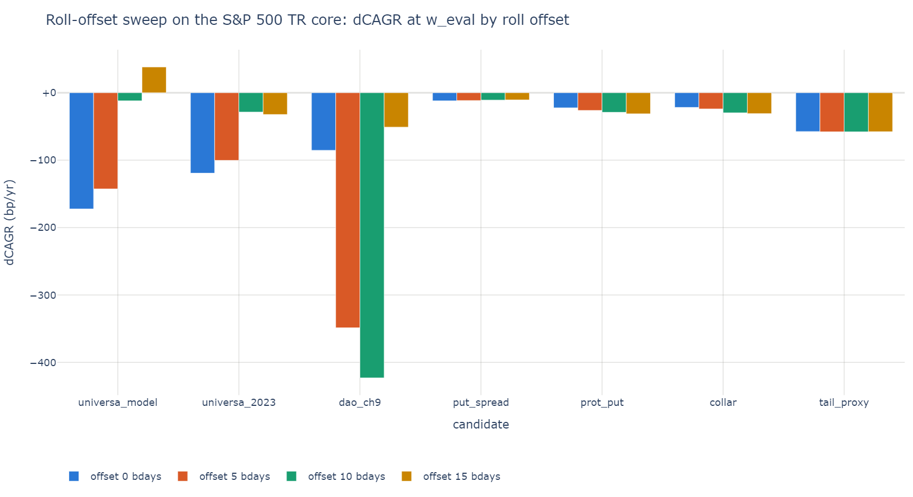

<details>
<summary>Table t06_robustness: rolling 10-year win rate and block-bootstrap P(beat) at w_eval (click to expand)</summary>

| core | candidate | w_eval | rolling10_win_rate | p_beat_5y | p_beat_10y | p_beat_20y |
|---|---|---|---|---|---|---|
| spx | universa_model | 3.33% | 0.56% | 13.30% | 4.25% | 0.95% |
| spx | universa_2023 | 2.00% | 0.16% | 2.95% | 0.95% | 0.00% |
| spx | dao_ch9 | 0.50% | 35.83% | 24.65% | 28.65% | 37.55% |
| spx | put_spread | 0.25% | 0.00% | 1.70% | 0.10% | 0.05% |
| spx | prot_put | 5.00% | 0.01% | 13.75% | 6.10% | 2.30% |
| spx | collar | 5.00% | 9.06% | 15.70% | 8.30% | 3.50% |
| spx | pput_idx | 5.00% | 8.97% | 15.50% | 6.30% | 0.80% |
| spx | pput3m_idx | 5.00% | 0.00% | 16.05% | 5.00% | 0.70% |
| spx | cll_idx | 5.00% | 0.00% | 0.45% | 0.00% | 0.00% |
| spx | vxth_idx | 10.00% | 63.88% | 44.95% | 51.45% | 52.15% |
| spx | tail | 5.00% | n/a | 0.00% | 0.00% | 0.00% |
| spx | tail_proxy | 5.00% | 15.38% | 22.45% | 13.65% | 7.35% |
| spx | tbills | 5.00% | 15.65% | 23.30% | 11.85% | 4.90% |
| spx | ust10 | 5.00% | 46.28% | 28.45% | 31.85% | 24.30% |
| spx | tlt | 5.00% | 44.24% | 24.00% | 35.05% | 19.75% |
| spx | ief | 5.00% | 37.69% | 22.10% | 29.25% | 13.30% |
| spx | gold | 35.00% | 27.75% | 50.80% | 53.45% | 56.65% |
| spx | trend | 75.00% | 65.51% | 43.40% | 57.70% | 56.45% |
| spx | dbmf | 5.00% | n/a | 27.70% | 15.45% | 7.70% |
| spx | sixty_forty | 40.00% | 22.01% | 27.40% | 21.70% | 13.80% |
| 6040 | universa_model | 3.33% | 0.34% | 13.30% | 2.65% | 0.25% |
| 6040 | universa_2023 | 2.00% | 0.10% | 1.60% | 0.35% | 0.00% |
| 6040 | dao_ch9 | 0.50% | 24.61% | 24.60% | 27.15% | 29.20% |
| 6040 | put_spread | 0.25% | 0.00% | 0.75% | 0.00% | 0.00% |
| 6040 | prot_put | 5.00% | 0.00% | 8.90% | 2.70% | 0.45% |
| 6040 | collar | 5.00% | 1.08% | 11.05% | 4.25% | 1.15% |
| 6040 | pput_idx | 5.00% | 26.69% | 33.30% | 26.90% | 24.70% |
| 6040 | pput3m_idx | 100.00% | 52.61% | 61.40% | 60.15% | 67.80% |
| 6040 | cll_idx | 5.00% | 73.43% | 49.95% | 45.65% | 37.25% |
| 6040 | vxth_idx | 100.00% | 72.69% | 50.50% | 58.00% | 76.20% |
| 6040 | tail | 5.00% | n/a | 0.00% | 0.00% | 0.00% |
| 6040 | tail_proxy | 5.00% | 10.53% | 19.70% | 6.90% | 1.45% |
| 6040 | tbills | 5.00% | 7.25% | 13.25% | 4.10% | 0.40% |
| 6040 | ust10 | 5.00% | 21.69% | 25.35% | 20.25% | 13.20% |
| 6040 | tlt | 5.00% | 44.41% | 30.75% | 30.75% | 17.25% |
| 6040 | ief | 5.00% | 9.69% | 21.45% | 13.05% | 5.35% |
| 6040 | gold | 100.00% | 28.59% | 61.20% | 62.30% | 68.90% |
| 6040 | trend | 100.00% | 89.10% | 84.40% | 92.70% | 98.75% |
| 6040 | dbmf | 55.00% | n/a | 51.70% | 61.40% | 69.80% |
| 6040 | sixty_forty | 40.00% | 17.13% | 24.30% | 15.35% | 7.30% |
| tech | universa_model | 3.33% | 20.49% | 13.25% | 18.35% | 6.45% |
| tech | universa_2023 | 2.00% | 0.10% | 1.50% | 0.25% | 0.00% |
| tech | dao_ch9 | 0.50% | 39.31% | 24.65% | 28.60% | 33.90% |
| tech | put_spread | 0.25% | 0.00% | 7.00% | 1.05% | 0.05% |
| tech | prot_put | 5.00% | 0.01% | 13.15% | 5.40% | 2.05% |
| tech | collar | 5.00% | 10.65% | 15.60% | 8.95% | 3.45% |
| tech | pput_idx | 5.00% | 0.00% | 4.65% | 0.65% | 0.05% |
| tech | pput3m_idx | 5.00% | 0.00% | 1.85% | 0.35% | 0.00% |
| tech | cll_idx | 5.00% | 0.00% | 0.10% | 0.00% | 0.00% |
| tech | vxth_idx | 5.00% | 0.00% | 11.75% | 2.30% | 0.20% |
| tech | tail | 5.00% | n/a | 0.15% | 0.00% | 0.00% |
| tech | tail_proxy | 5.00% | 11.78% | 18.30% | 9.95% | 3.05% |
| tech | tbills | 5.00% | 0.49% | 9.65% | 2.50% | 0.25% |
| tech | ust10 | 5.00% | 9.20% | 19.00% | 10.55% | 2.95% |
| tech | tlt | 5.00% | 20.51% | 22.05% | 15.25% | 5.40% |
| tech | ief | 5.00% | 0.00% | 21.35% | 5.80% | 1.75% |
| tech | gold | 5.00% | 0.00% | 26.05% | 17.05% | 7.50% |
| tech | trend | 5.00% | 0.00% | 13.85% | 5.70% | 1.30% |
| tech | dbmf | 5.00% | n/a | 15.35% | 3.80% | 1.00% |
| tech | sixty_forty | 40.00% | 0.33% | 10.60% | 2.60% | 0.20% |

</details>

<details>
<summary>Table t06b_decades: dCAGR at w_eval by decade (bp/yr) (click to expand)</summary>

| core | candidate | w_eval | d_1990s_bp | d_2000s_bp | d_2010s_bp | d_2020s_bp |
|---|---|---|---|---|---|---|
| spx | universa_model | 3.33% | -280 | -41 | -242 | -135 |
| spx | universa_2023 | 2.00% | -178 | -81 | -148 | -55 |
| spx | dao_ch9 | 0.50% | -546 | -3 | -419 | +1012 |
| spx | put_spread | 0.25% | -18 | -5 | -14 | -12 |
| spx | prot_put | 5.00% | -36 | -10 | -25 | -20 |
| spx | collar | 5.00% | -27 | +0 | -34 | -32 |
| spx | pput_idx | 5.00% | -30 | +0 | -19 | -15 |
| spx | pput3m_idx | 5.00% | n/a | -1 | -19 | -10 |
| spx | cll_idx | 5.00% | n/a | +21 | -29 | -24 |
| spx | vxth_idx | 10.00% | n/a | +52 | -46 | +39 |
| spx | tail | 5.00% | n/a | n/a | -101 | -111 |
| spx | tail_proxy | 5.00% | -107 | +59 | -99 | -123 |
| spx | tbills | 5.00% | -61 | +30 | -62 | -58 |
| spx | ust10 | 5.00% | -47 | +59 | -43 | -81 |
| spx | tlt | 5.00% | n/a | +40 | -24 | -101 |
| spx | ief | 5.00% | n/a | +25 | -42 | -79 |
| spx | gold | 35.00% | n/a | +674 | -331 | +58 |
| spx | trend | 75.00% | +18 | +401 | -208 | -211 |
| spx | dbmf | 5.00% | n/a | n/a | -25 | -19 |
| spx | sixty_forty | 40.00% | -387 | +377 | -383 | -597 |
| 6040 | universa_model | 3.33% | -267 | -88 | -232 | -118 |
| 6040 | universa_2023 | 2.00% | -168 | -96 | -140 | -54 |
| 6040 | dao_ch9 | 0.50% | -533 | -49 | -417 | +780 |
| 6040 | put_spread | 0.25% | -17 | -7 | -14 | -11 |
| 6040 | prot_put | 5.00% | -19 | -8 | -14 | -13 |
| 6040 | collar | 5.00% | -15 | -3 | -19 | -20 |
| 6040 | pput_idx | 5.00% | -10 | -19 | -1 | +17 |
| 6040 | pput3m_idx | 100.00% | n/a | -164 | -33 | +451 |
| 6040 | cll_idx | 5.00% | n/a | +76 | -11 | +9 |
| 6040 | vxth_idx | 100.00% | n/a | +79 | -119 | +693 |
| 6040 | tail | 5.00% | n/a | n/a | -84 | -81 |
| 6040 | tail_proxy | 5.00% | -89 | +20 | -84 | -92 |
| 6040 | tbills | 5.00% | -43 | +4 | -46 | -27 |
| 6040 | ust10 | 5.00% | -30 | +28 | -28 | -50 |
| 6040 | tlt | 5.00% | n/a | +17 | -10 | -69 |
| 6040 | ief | 5.00% | n/a | +8 | -27 | -47 |
| 6040 | gold | 100.00% | n/a | +1606 | -711 | +674 |
| 6040 | trend | 100.00% | +412 | +162 | +75 | +375 |
| 6040 | dbmf | 55.00% | n/a | n/a | -34 | +66 |
| 6040 | sixty_forty | 40.00% | -241 | +186 | -251 | -339 |
| tech | universa_model | 3.33% | -344 | +7 | -284 | -216 |
| tech | universa_2023 | 2.00% | -237 | -121 | -183 | -112 |
| tech | dao_ch9 | 0.50% | -640 | +3 | -468 | +1076 |
| tech | put_spread | 0.25% | -23 | -6 | -17 | -16 |
| tech | prot_put | 5.00% | -48 | -14 | -32 | -30 |
| tech | collar | 5.00% | -38 | +2 | -44 | -45 |
| tech | pput_idx | 5.00% | -108 | -71 | -82 | -103 |
| tech | pput3m_idx | 5.00% | n/a | -122 | -82 | -96 |
| tech | cll_idx | 5.00% | n/a | -1119 | -92 | -108 |
| tech | vxth_idx | 5.00% | n/a | -37 | -84 | -80 |
| tech | tail | 5.00% | n/a | n/a | -190 | -188 |
| tech | tail_proxy | 5.00% | -186 | +44 | -161 | -201 |
| tech | tbills | 5.00% | -142 | -19 | -126 | -128 |
| tech | ust10 | 5.00% | -124 | +26 | -105 | -162 |
| tech | tlt | 5.00% | n/a | -26 | -85 | -191 |
| tech | ief | 5.00% | n/a | -55 | -103 | -159 |
| tech | gold | 5.00% | n/a | +17 | -106 | -63 |
| tech | trend | 5.00% | -79 | -29 | -74 | -91 |
| tech | dbmf | 5.00% | n/a | n/a | -124 | -75 |
| tech | sixty_forty | 40.00% | -1047 | -180 | -892 | -1290 |

</details>

**Table t06c_roll_offsets: roll-offset sweep: dCAGR at w_eval with rolls k business days later (bp/yr).**

| core | candidate | w_eval | d_cagr_off0_bp | d_cagr_off5_bp | d_cagr_off10_bp | d_cagr_off15_bp | spread_bp |
|---|---|---|---|---|---|---|---|
| spx | universa_model | 3.33% | -172 | -143 | -12 | +38 | +210 |
| spx | universa_2023 | 2.00% | -119 | -100 | -29 | -32 | +91 |
| spx | dao_ch9 | 0.50% | -85 | -348 | -423 | -51 | +372 |
| spx | put_spread | 0.25% | -12 | -12 | -11 | -11 | +1 |
| spx | prot_put | 5.00% | -22 | -26 | -29 | -31 | +9 |
| spx | collar | 5.00% | -22 | -24 | -30 | -31 | +9 |
| spx | tail_proxy | 5.00% | -58 | -58 | -58 | -58 | +0 |
| 6040 | universa_model | 3.33% | -179 | -155 | -37 | +8 | +187 |
| 6040 | universa_2023 | 2.00% | -119 | -102 | -38 | -40 | +81 |
| 6040 | dao_ch9 | 0.50% | -131 | -363 | -423 | -90 | +333 |
| 6040 | put_spread | 0.25% | -12 | -12 | -11 | -11 | +1 |
| 6040 | prot_put | 5.00% | -13 | -15 | -16 | -17 | +4 |
| 6040 | collar | 5.00% | -13 | -14 | -17 | -17 | +4 |
| 6040 | tail_proxy | 5.00% | -57 | -57 | -57 | -57 | +0 |
| tech | universa_model | 3.33% | -204 | -160 | -13 | +45 | +249 |
| tech | universa_2023 | 2.00% | -167 | -149 | -77 | -80 | +90 |
| tech | dao_ch9 | 0.50% | -117 | -407 | -491 | -65 | +426 |
| tech | put_spread | 0.25% | -15 | -15 | -14 | -14 | +2 |
| tech | prot_put | 5.00% | -31 | -35 | -39 | -42 | +12 |
| tech | collar | 5.00% | -29 | -32 | -39 | -41 | +12 |
| tech | tail_proxy | 5.00% | -115 | -116 | -116 | -115 | +0 |

<details>
<summary>Table t06d_book_bootstrap: book bootstrap, insurance archetype: 25-year median dCAGR and P(beat) by mode (click to expand)</summary>

| core | candidate | w_eval | years | joint_d_cagr_p50_bp | joint_p_beat | reshuffle_d_cagr_p50_bp | reshuffle_p_beat | no_crash_d_cagr_p50_bp | no_crash_p_beat |
|---|---|---|---|---|---|---|---|---|---|
| spx | universa_model | 3.33% | 35 | -177 | 2.61% | -198 | 0.07% | -239 | 0.00% |
| spx | universa_2023 | 2.00% | 35 | -122 | 0.03% | -131 | 0.00% | -145 | 0.01% |
| spx | dao_ch9 | 0.50% | 35 | -115 | 35.28% | -174 | 29.72% | -145 | 19.82% |
| spx | put_spread | 0.25% | 35 | -12 | 0.02% | -13 | 0.00% | -16 | 0.00% |
| spx | prot_put | 5.00% | 35 | -22 | 1.03% | -12 | 32.13% | -29 | 0.01% |
| spx | collar | 5.00% | 35 | -23 | 1.77% | -13 | 30.11% | -33 | 0.00% |
| spx | pput_idx | 5.00% | 35 | -15 | 4.25% | -5 | 42.86% | -22 | 0.00% |
| spx | pput3m_idx | 5.00% | 21 | -11 | 5.11% | +0 | 50.43% | -18 | 0.00% |
| spx | cll_idx | 5.00% | 16 | -27 | 0.00% | -21 | 14.58% | -31 | 0.00% |
| spx | vxth_idx | 10.00% | 19 | +3 | 52.56% | +28 | 65.77% | -10 | 43.66% |
| spx | tail | 5.00% | 8 | -95 | 0.00% | -97 | 0.00% | -119 | 0.00% |
| spx | tail_proxy | 5.00% | 35 | -62 | 6.57% | -69 | 0.55% | -102 | 0.00% |
| spx | gold | 35.00% | 21 | +66 | 65.83% | +75 | 65.01% | -83 | 28.33% |
| 6040 | universa_model | 3.33% | 35 | -184 | 0.63% | -194 | 0.09% | -225 | 0.00% |
| 6040 | universa_2023 | 2.00% | 35 | -121 | 0.02% | -125 | 0.00% | -136 | 0.00% |
| 6040 | dao_ch9 | 0.50% | 35 | -159 | 29.07% | -177 | 26.57% | -185 | 17.61% |
| 6040 | put_spread | 0.25% | 35 | -13 | 0.00% | -13 | 0.00% | -14 | 0.00% |
| 6040 | prot_put | 5.00% | 35 | -13 | 0.15% | -9 | 28.40% | -15 | 0.00% |
| 6040 | collar | 5.00% | 35 | -14 | 0.60% | -9 | 25.94% | -17 | 0.00% |
| 6040 | pput_idx | 5.00% | 35 | -4 | 21.65% | +2 | 54.58% | -4 | 26.56% |
| 6040 | pput3m_idx | 100.00% | 21 | +56 | 67.09% | +61 | 56.69% | +121 | 83.42% |
| 6040 | cll_idx | 5.00% | 16 | -4 | 26.44% | +0 | 49.20% | -5 | 20.94% |
| 6040 | vxth_idx | 100.00% | 19 | +164 | 70.71% | +188 | 64.94% | +286 | 81.96% |
| 6040 | tail | 5.00% | 8 | -73 | 0.00% | -73 | 0.00% | -90 | 0.00% |
| 6040 | tail_proxy | 5.00% | 35 | -60 | 1.66% | -62 | 0.09% | -77 | 0.00% |
| 6040 | gold | 100.00% | 21 | +318 | 80.72% | +312 | 76.60% | +120 | 62.77% |
| tech | universa_model | 3.33% | 35 | -205 | 4.69% | -252 | 0.07% | -333 | 0.00% |
| tech | universa_2023 | 2.00% | 35 | -170 | 0.02% | -193 | 0.01% | -227 | 0.00% |
| tech | dao_ch9 | 0.50% | 35 | -154 | 33.68% | -268 | 29.04% | -197 | 20.14% |
| tech | put_spread | 0.25% | 35 | -16 | 0.18% | -17 | 0.00% | -23 | 0.00% |
| tech | prot_put | 5.00% | 35 | -31 | 0.93% | +39 | 70.81% | -42 | 0.01% |
| tech | collar | 5.00% | 35 | -31 | 2.02% | +36 | 69.81% | -49 | 0.00% |
| tech | pput_idx | 5.00% | 35 | -90 | 0.84% | -70 | 10.80% | -147 | 0.00% |
| tech | pput3m_idx | 5.00% | 21 | -93 | 0.45% | -70 | 12.65% | -145 | 0.00% |
| tech | cll_idx | 5.00% | 16 | -101 | 0.01% | -89 | 1.68% | -128 | 0.00% |
| tech | vxth_idx | 5.00% | 19 | -73 | 3.48% | -43 | 26.21% | -128 | 0.00% |
| tech | tail | 5.00% | 8 | -172 | 0.01% | -172 | 0.03% | -258 | 0.00% |
| tech | tail_proxy | 5.00% | 35 | -122 | 6.10% | -138 | 0.70% | -238 | 0.00% |
| tech | gold | 5.00% | 21 | -62 | 13.61% | -54 | 20.16% | -139 | 0.00% |
| S&P 500 1928-latest (book cartoon) | insurance cartoon | 3.00% | 98 | +58 | 54.39% | -75 | 28.97% | -342 | 0.00% |

</details>

The Universa sleeve at 3.33% beats the unhedged S&P 500 in 0.56% of rolling 10-year windows and in 4.25% of 10-year block-bootstrap paths, and it trails in every decade (-280, -41, -242 and -135 bp). The Dao preset at 0.50% wins 35.83% of rolling windows; its decades run -546, -3, -419 and +1012 bp, so its record is the 2020s, and within them one quarter. The roll calendar alone moves the option results a lot: rolling 15 business days later turns the Universa sleeve's -172 bp into +38 bp (a 210 bp spread across offsets) and the Dao preset's spread is 372 bp, while the near-money sleeves move by 1 to 9 bp. The book bootstrap separates mechanism from luck: the book's insurance cartoon at 3% gains +58 bp with the crash link intact and loses -75 bp when its years are reshuffled, as a true insurance payoff should; the Universa sleeve loses in all three modes (-177, -198 and -239 bp), and gold's gain survives the reshuffle (+66 bp joint, +75 bp reshuffled), so it does not come from paying in crash years. [P(beat) at 10 years by candidate](figures/cs_06_pbeat10.png).

### 7. Dice: regimes, cartoons and the breakeven crash frequency

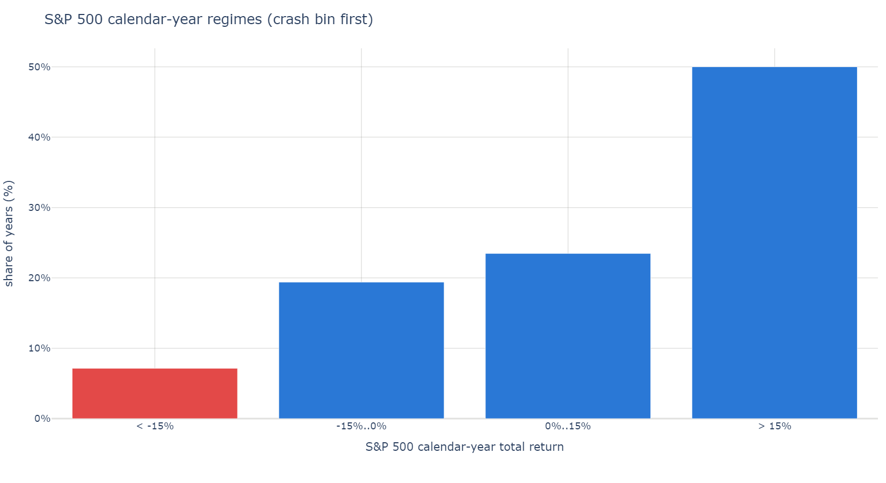

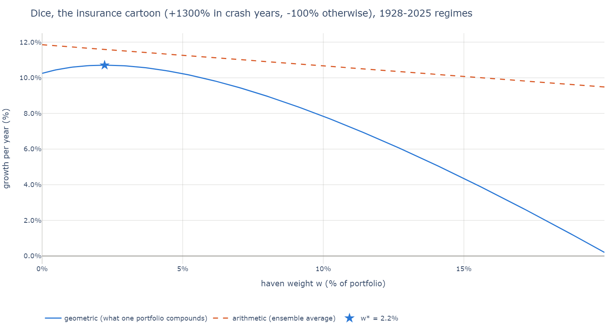

**Table t07_regimes: S&P 500 calendar-year regimes 1928-2025.**

| label | count | freq | mean_ret |
|---|---|---|---|
| < -15% | 7 | 7.14% | -29.54% |
| -15%..0% | 19 | 19.39% | -7.58% |
| 0%..15% | 23 | 23.47% | 7.55% |
| > 15% | 49 | 50.00% | 27.32% |

**Table t07b_cartoons: the book's cartoon havens, reset annually: dCAGR over the S&P 500 (bp/yr).**

book_reported_bp: Universa, Safe Haven Investing Part One (2017), 1997-2016, as reported.

| haven | w | window | years | crash_years | d_cagr_bp | book_reported_bp |
|---|---|---|---|---|---|---|
| insurance | 3.00% | 1997-2016 | 20 | 2 | +66 | +67 |
| insurance | 10.00% | 1997-2016 | 20 | 2 | -112 | n/a |
| alpha | 3.00% | 1997-2016 | 20 | 2 | +6 | n/a |
| alpha | 10.00% | 1997-2016 | 20 | 2 | +18 | +18 |
| store of value (CPI + 2%) | 3.00% | 1997-2016 | 20 | 2 | -5 | n/a |
| store of value (CPI + 2%) | 10.00% | 1997-2016 | 20 | 2 | -18 | -17 |
| store of value (per-bin cartoon) | 3.00% | 1997-2016 | 20 | 2 | -2 | n/a |
| store of value (per-bin cartoon) | 10.00% | 1997-2016 | 20 | 2 | -9 | n/a |
| insurance | 3.00% | 1928-2025 | 98 | 7 | +45 | n/a |
| insurance | 10.00% | 1928-2025 | 98 | 7 | -235 | n/a |
| alpha | 3.00% | 1928-2025 | 98 | 7 | -1 | n/a |
| alpha | 10.00% | 1928-2025 | 98 | 7 | -5 | n/a |
| store of value (CPI + 2%) | 3.00% | 1928-2025 | 98 | 7 | -9 | n/a |
| store of value (CPI + 2%) | 10.00% | 1928-2025 | 98 | 7 | -32 | n/a |
| store of value (per-bin cartoon) | 3.00% | 1928-2025 | 98 | 7 | -9 | n/a |
| store of value (per-bin cartoon) | 10.00% | 1928-2025 | 98 | 7 | -32 | n/a |

<details>
<summary>Table t07c_dice: estimated-mode dice of the model-priced sleeves at w_eval (1928-latest regime frequencies) (click to expand)</summary>

| core | candidate | w_eval | years_per_regime | haven < -15% | haven -15%..0% | haven 0%..15% | haven > 15% | cost_effective | kelly_w | breakeven_pi | hist_pi | dice_d_cagr_bp |
|---|---|---|---|---|---|---|---|---|---|---|---|---|
| spx | universa_model | 3.33% | 3/3/11/18 | 54.59% | -47.04% | -65.78% | -50.56% | no | 0.00% | 35.19% | 7.14% | -172 |
| spx | universa_2023 | 2.00% | 3/3/11/18 | -7.35% | -30.64% | -65.05% | -56.14% | no | 0.00% | 69.79% | 7.14% | -113 |
| spx | dao_ch9 | 0.50% | 3/3/11/18 | 1141.24% | -239.52% | -820.65% | 548.09% | yes | 2.32% | 1.47% | 7.14% | +44 |
| spx | put_spread | 0.25% | 3/3/11/18 | 14.36% | -7.18% | -52.28% | -52.35% | no | 0.00% | 46.65% | 7.14% | -11 |
| spx | prot_put | 5.00% | 3/3/11/18 | -20.41% | -8.55% | 2.58% | 17.94% | no | 0.00% | 38.80% | 7.14% | -20 |
| spx | collar | 5.00% | 3/3/11/18 | -15.68% | -10.31% | 1.89% | 17.37% | no | 0.00% | 28.33% | 7.14% | -22 |
| spx | tail_proxy | 5.00% | 3/3/11/18 | 19.86% | 6.63% | -4.33% | -8.82% | no | 0.00% | 18.75% | 7.14% | -49 |
| 6040 | universa_model | 3.33% | 3/3/11/18 | 54.59% | -47.04% | -65.78% | -50.56% | no | 0.00% | 41.99% | 7.14% | -174 |
| 6040 | universa_2023 | 2.00% | 3/3/11/18 | -5.81% | -35.01% | -65.44% | -54.53% | no | 0.00% | 85.53% | 7.14% | -113 |
| 6040 | dao_ch9 | 0.50% | 3/3/11/18 | 1343.41% | -313.20% | -830.11% | 313.38% | no | 0.00% | 7.44% | 7.14% | -8 |
| 6040 | put_spread | 0.25% | 3/3/11/18 | 14.37% | -7.18% | -52.28% | -52.35% | no | 0.00% | 58.67% | 7.14% | -11 |
| 6040 | prot_put | 5.00% | 3/3/11/18 | -11.20% | -2.41% | 4.43% | 12.85% | no | 0.00% | 43.86% | 7.14% | -12 |
| 6040 | collar | 5.00% | 3/3/11/18 | -8.32% | -3.42% | 4.05% | 12.42% | no | 0.00% | 31.83% | 7.14% | -13 |
| 6040 | tail_proxy | 5.00% | 3/3/11/18 | 19.86% | 6.64% | -4.33% | -8.82% | no | 0.00% | 24.40% | 7.14% | -49 |
| tech | universa_model | 3.33% | 3/3/11/18 | 54.59% | -47.05% | -65.79% | -50.58% | no | 0.00% | 29.05% | 7.14% | -225 |
| tech | universa_2023 | 2.00% | 3/3/11/18 | -12.95% | -16.24% | -78.03% | -75.75% | no | 0.00% | 59.84% | 7.14% | -168 |
| tech | dao_ch9 | 0.50% | 3/3/11/18 | 784.23% | 16.23% | -915.91% | 850.99% | yes | 4.70% | n/a | 7.14% | +110 |
| tech | put_spread | 0.25% | 3/3/11/18 | 14.36% | -7.18% | -52.29% | -52.36% | no | 0.00% | 37.69% | 7.14% | -15 |
| tech | prot_put | 5.00% | 3/3/11/18 | -36.03% | 14.02% | 22.28% | 48.29% | no | 0.00% | 36.16% | 7.14% | -27 |
| tech | collar | 5.00% | 3/3/11/18 | -31.74% | 9.07% | 21.38% | 48.32% | no | 0.00% | 27.46% | 7.14% | -30 |
| tech | tail_proxy | 5.00% | 3/3/11/18 | 19.85% | 6.63% | -4.34% | -8.83% | no | 0.00% | 22.81% | 7.14% | -142 |
| S&P 500 1928-latest (book cartoon) | insurance cartoon | 3.00% | 7/19/23/49 | 1300.00% | -100.00% | -100.00% | -100.00% | yes | 2.22% | 5.03% | 7.14% | +41 |

</details>

**Table t07d_crash_sweep: dice dCAGR by crash-year frequency pi.**

| pi | insurance cartoon at 3% | universa_model at 3.33% | universa_2023 at 2.00% | dao_ch9 at 0.50% | put_spread at 0.25% | prot_put at 5.00% | collar at 5.00% | tail_proxy at 5.00% |
|---|---|---|---|---|---|---|---|---|
| 0.00% | -3.42% | -2.21% | -1.29% | -0.17% | -0.13% | -0.26% | -0.30% | -0.81% |
| 2.50% | -2.06% | -2.04% | -1.24% | 0.05% | -0.13% | -0.24% | -0.27% | -0.69% |
| 5.00% | -0.72% | -1.87% | -1.18% | 0.26% | -0.12% | -0.22% | -0.24% | -0.58% |
| 7.50% | 0.60% | -1.70% | -1.12% | 0.47% | -0.11% | -0.20% | -0.22% | -0.48% |
| 10.00% | 1.91% | -1.53% | -1.06% | 0.68% | -0.10% | -0.18% | -0.19% | -0.37% |
| 15.00% | 4.49% | -1.21% | -0.96% | 1.08% | -0.09% | -0.15% | -0.13% | -0.16% |
| 20.00% | 7.00% | -0.90% | -0.85% | 1.46% | -0.07% | -0.11% | -0.08% | 0.03% |

Seven of the 98 calendar years from 1928 to 2025 were crash years (S&P 500 at or below -15%), 7.14%, averaging -29.54%. The book's cartoons reproduce Universa's Part One figures on 1997-2016: insurance at 3% adds +66 bp (reported +67), alpha at 10% +18 bp (reported +18) and a CPI + 2% store of value at 10% -18 bp (reported -17). On the full 1928-2025 table the zero-mean insurance cartoon still adds +45 bp at 3% but costs -235 bp at 10%; its Kelly weight is 2.22% and it pays only when crashes come more often than 5.03% of years, against 7.14% in history. The real sleeves do not have the cartoon's payoff: in estimated mode the Universa sleeve at 3.33% earns 54.59% in crash years and loses -47.04% to -65.78% in the others, so it needs a crash frequency of 35.19% to break even. The Dao preset looks cost-effective in estimated mode on the S&P 500 core (Kelly 2.32%, breakeven 1.47%, +44 bp), but its haven return in the top bin (548.09%) is the 2020 payoff, an up year for the S&P 500, and the sample since 1990 has three crash years (3/3/11/18). The crash-frequency sweep makes the same point: the cartoon's dCAGR turns positive between a 5.00% and a 7.50% crash frequency, while the Universa sleeve stays negative at 20.00% (-0.90%). [Crash-frequency sweep chart](figures/cs_07_crash_freq_cartoon.png).

### 8. Pricing sensitivity

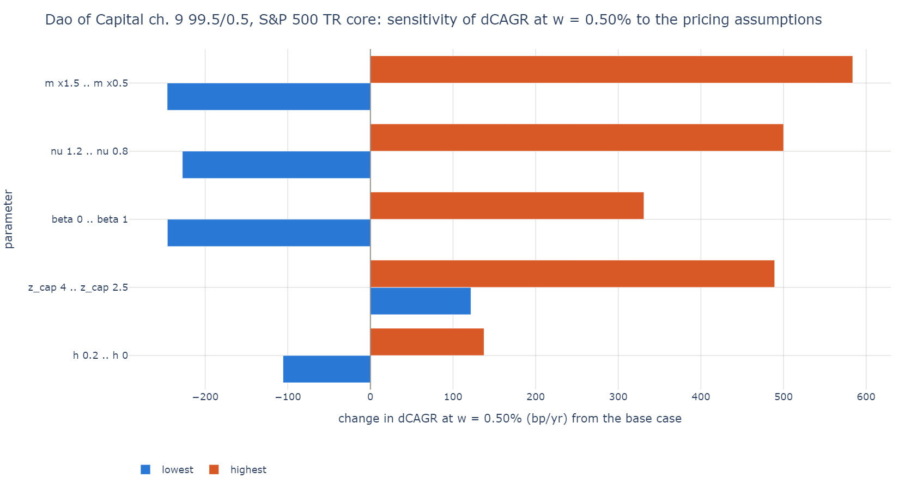

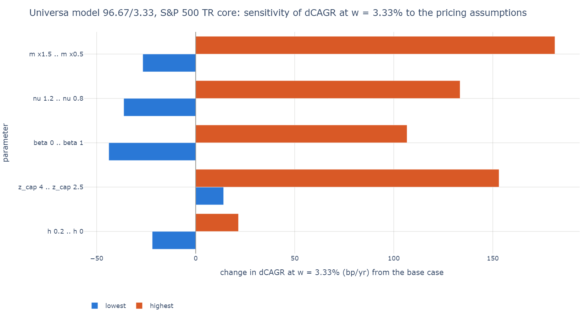

**Table t08_sensitivity_dao_ch9: dao_ch9 on the S&P 500 TR core: w* and dCAGR at w = 0.50% by pricing assumption.**

base: m 1, nu 1, h 0.04, z_cap inf, beta 0.5.

| parameter | setting | w_star | d_cagr_bp |
|---|---|---|---|
| base | base | 0.00% | -85 |
| m | m x0.5 | 0.75% | +498 |
| m | m x0.75 | 0.50% | +184 |
| m | m x1 | 0.00% | -85 |
| m | m x1.25 | 0.00% | -280 |
| m | m x1.5 | 0.00% | -331 |
| nu | nu 0.8 | 0.75% | +415 |
| nu | nu 0.9 | 0.25% | +124 |
| nu | nu 1 | 0.00% | -85 |
| nu | nu 1.1 | 0.00% | -227 |
| nu | nu 1.2 | 0.00% | -313 |
| h | h 0 | 0.25% | +52 |
| h | h 0.05 | 0.00% | -90 |
| h | h 0.1 | 0.00% | -119 |
| h | h 0.2 | 0.00% | -191 |
| z_cap | z_cap 2.5 | 0.75% | +404 |
| z_cap | z_cap 3 | 0.50% | +258 |
| z_cap | z_cap 4 | 0.25% | +36 |
| beta | beta 0 | 0.00% | -331 |
| beta | beta 0.5 | 0.00% | -85 |
| beta | beta 1 | 0.50% | +246 |

**Table t08_sensitivity_universa_model: universa_model on the S&P 500 TR core: w* and dCAGR at w = 3.33% by pricing assumption.**

base: m 1, nu 1, h 0.04, z_cap inf, beta 0.5.

| parameter | setting | w_star | d_cagr_bp |
|---|---|---|---|
| base | base | 0.00% | -172 |
| m | m x0.5 | 1.75% | +9 |
| m | m x0.75 | 0.00% | -117 |
| m | m x1 | 0.00% | -172 |
| m | m x1.25 | 0.00% | -194 |
| m | m x1.5 | 0.00% | -199 |
| nu | nu 0.8 | 0.25% | -39 |
| nu | nu 0.9 | 0.00% | -124 |
| nu | nu 1 | 0.00% | -172 |
| nu | nu 1.1 | 0.00% | -197 |
| nu | nu 1.2 | 0.00% | -209 |
| h | h 0 | 0.00% | -151 |
| h | h 0.05 | 0.00% | -173 |
| h | h 0.1 | 0.00% | -180 |
| h | h 0.2 | 0.00% | -194 |
| z_cap | z_cap 2.5 | 0.75% | -19 |
| z_cap | z_cap 3 | 0.00% | -86 |
| z_cap | z_cap 4 | 0.00% | -158 |
| beta | beta 0 | 0.00% | -216 |
| beta | beta 0.5 | 0.00% | -172 |
| beta | beta 1 | 0.00% | -66 |

The Universa sleeve's verdict holds across most of the sweep: from a base of -172 bp at 3.33%, only halving the wing slope (m x0.5) gives it a positive w* (1.75%, +9 bp); pricing at 0.8 times the variance-swap volatility (nu 0.8) narrows the loss to -39 bp, a flat wing past 2.5 standard deviations to -19 bp, and the proportional SKEW rule (beta 1) to -66 bp. The Dao preset's verdict does not hold: from a base of -85 bp at 0.50%, it turns positive with m x0.75 (+184 bp), nu 0.9 (+124 bp), mid fills (h 0, +52 bp), any finite wing cap (+36 to +404 bp) or beta 1 (+246 bp), and falls to -331 bp with m x1.5 or beta 0. Its result is set by the price of puts far out in the wing, which no free index validates (experiment 9). The spread (h) moves both presets least.

### 9. Validation recap

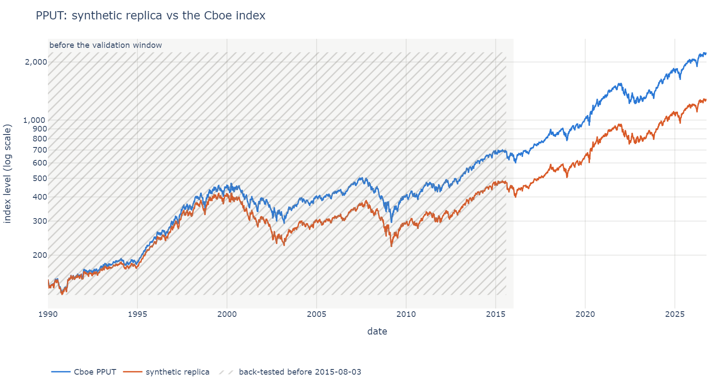

**Table t09_validation: pricer validation against Cboe PPUT, PPUT3M and CLL (out of sample).**

| target | window_start | window_end | n_months | te | te_tol | te_ex_bad | dcagr | dcagr_tol | corr | corr_tol | dmaxdd | te_roll | te_nonroll | passed |
|---|---|---|---|---|---|---|---|---|---|---|---|---|---|---|
| PPUT | 2015-12-31 | 2026-10-09 | 130 | 1.19% | 1.50% | 1.19% | -1.68% | 0.50% | 0.981 | 0.9 | 0.95% | 3.99% | 1.29% | no |
| PPUT3M | 2015-12-31 | 2026-10-09 | 130 | 0.92% | 2.00% | 0.92% | -1.33% | 0.75% | 0.981 | 0.85 | -0.48% | 3.00% | 2.33% | no |
| CLL | 2008-08-26 | 2026-10-09 | 218 | 3.59% | 2.50% | 2.77% | -0.71% | 1.00% | 0.947 | 0.85 | 5.29% | 5.79% | 3.90% | no |

**Table t09b_universa: Universa known-answer checks: the 96.67/3.33 model portfolio (informational).**

universa_reported: self-reported, hypothetical, window-dependent. ours: universa_model at 3.33% on the S&P 500 TR core.

| check | universa_reported | ours | gap | spx_reported | spx_ours | label |
|---|---|---|---|---|---|---|
| March 2020 | 0.40% | -7.31% | -7.71% | -12.40% | -12.35% | self-reported, hypothetical, window-dependent |
| Q1 2020 | -6.30% | -11.62% | -5.32% | -19.60% | -19.60% | self-reported, hypothetical, window-dependent |
| 2019 sleeve drag (portfolio points) | -1.69% | -2.26% | -0.57% | 31.50% | 31.49% | self-reported, hypothetical, window-dependent |
| Mar-Dec 2008 | 9.90% | -19.06% | -28.96% | -30.70% | -30.73% | self-reported, hypothetical, window-dependent |

Out of sample, the pricer tracks the near-money put-protection indices' path closely but misses their level: PPUT's tracking error is 1.19% a year (tolerance 1.50%) with a hedge-P&L correlation of 0.981, but the replica's CAGR trails Cboe's by -1.68% a year (tolerance 0.50%), and PPUT3M fails the same way (-1.33%). CLL fails on tracking error (3.59%, 2.77% without the months of Cboe's two likely bad marks). The model's near-money puts are richer than Cboe's fills, so the protective-put and collar results above are conservative; the far wing where the Universa and Dao presets live is not covered by any of these indices. The Universa known-answer checks are informational: our 96.67/3.33 portfolio trails Universa's self-reported figures in every window, by -7.71 points in March 2020 and -28.96 points in March-December 2008. Replica charts: [PPUT](figures/cs_09_replication_pput.png), [PPUT3M](figures/cs_09_replication_pput3m.png), [CLL](figures/cs_09_replication_cll.png).

### 10. Crisis windows

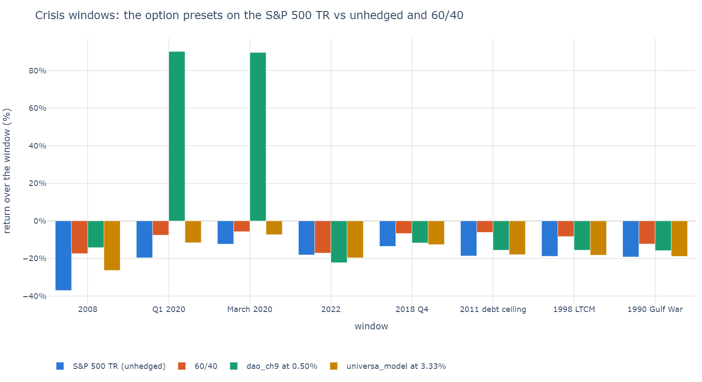

**Table t10_scenarios: crisis windows: hedged vs unhedged vs 60/40 (S&P 500 TR core).**

| window | start | end | S&P 500 TR (unhedged) | 60/40 | dao_ch9 at 0.50% | universa_model at 3.33% |
|---|---|---|---|---|---|---|
| 2008 | 2007-12-31 | 2008-12-31 | -37.00% | -17.38% | -14.19% | -26.35% |
| Q1 2020 | 2019-12-31 | 2020-03-31 | -19.60% | -7.57% | 90.16% | -11.62% |
| March 2020 | 2020-02-28 | 2020-03-31 | -12.35% | -5.74% | 89.62% | -7.31% |
| 2022 | 2021-12-31 | 2022-12-30 | -18.11% | -17.10% | -22.23% | -19.61% |
| 2018 Q4 | 2018-09-28 | 2018-12-31 | -13.52% | -6.69% | -11.72% | -12.59% |
| 2011 debt ceiling | 2011-04-29 | 2011-10-03 | -18.64% | -6.09% | -15.55% | -17.95% |
| 1998 LTCM | 1998-07-17 | 1998-10-08 | -18.84% | -8.29% | -15.55% | -18.20% |
| 1990 Gulf War | 1990-07-16 | 1990-10-11 | -19.18% | -12.29% | -15.78% | -18.84% |

The Universa sleeve at 3.33% softens every window a little (2008: -26.35% against -37.00% unhedged; Q1 2020: -11.62% against -19.60%), but the 60/40 falls less in every window (-17.38% and -7.57%). The Dao preset at 0.50% turns Q1 2020 into +90.16% and cuts 2008 to -14.19%, but loses more than the unhedged index in 2022 (-22.23% against -18.11%), a slow decline that its short-dated, far out-of-the-money puts did not reach. Windows are measured from the close at the start date to the close at the end date; 2011, 1998 and 1990 use the peak-to-trough dates of `metrics.CRASHES`.

## What the critics' tests show

- **"Hold less equity instead" (Israelov 2019; Ilmanen et al. 2020).** Supported for every option preset on the S&P 500 core: none beats the drawdown-matched T-bill mix (table t04), and Treasuries, gold and trend do. The two scorecards still disagree in places: the Dao preset beats deleveraging on the 60/40 core (+122 bp at 0.25%) without raising its CAGR.
- **"Protection is path-dependent" (Israelov 2019; Verdad 2021).** Supported: moving the roll calendar by 5 to 15 business days moves the Universa sleeve's dCAGR across a 210 bp range and the Dao preset's across 372 bp (table t06c).
- **"A tiny sleeve pays many times its cost" (Spitznagel).** Seen once under model prices: the Dao preset's Q1 2020 (+90.16% for the hedged portfolio). Over 36.8 years its base-case calm-year cost outweighs it (-85 bp), and the Universa sleeve never delivered the reported crash payoffs (March-December 2008: -19.06% against +9.90% reported).
- **"The cartoon is priced fair by construction" (the critics' reply to Safe Haven's examples).** Supported: the cartoons reproduce Part One within 1 bp (table t07b), but the priced sleeves' crash-year payoffs are far smaller than the cartoon's, and the cartoon's own gain disappears when its years are reshuffled (+58 bp joint, -75 bp reshuffled).
- **"A hedge lets you hold more equity" (Spitznagel; AQR concedes it in principle).** Partly: the overlays turn positive under relever funding, with deeper drawdowns, and the premium sleeves stay at w* = 0 (table t05).

## What the data cannot decide

- **Far-wing prices.** The Universa and Dao presets buy puts far out of the money. No free data set holds such quotes across volatility regimes, the validation indices cover only the near-money wing, and table t08 shows the Dao preset's sign flipping with the wing's slope and shape. A real end-of-day chain (`src/insureport/chains.py`) is the way to settle it.
- **Settlement and fills.** Cboe fills its indices at an intraday VWAP and settles at the AM Special Opening Quotation; the model uses the daily open as a proxy and closing marks, and Cboe's pre-2015 back-history fill convention cannot be identified from closing data. The level gap in table t09 is of this kind.
- **The volatility risk premium.** The model prices at the variance-swap level (nu 1); a market that sells crash insurance cheaper or dearer than that moves every option verdict (the nu rows of table t08).
- **The number of crashes.** The options-era sample holds three crash years (table t07c) and a handful of fast crashes, so a result like the Dao preset's rests on one quarter. The bootstraps resample the same few events; they cannot add new ones.
- **In-sample choices and hindsight.** w* is chosen on the history it is scored on, the presets come from published descriptions written after the fact, and the tech sample is today's winners.
- **Universa's record.** It is self-reported and hypothetical, with undisclosed live rules; table t09b uses it for consistency checks only.
- **The objective.** CAGR, Sharpe ratio and drawdown at equal return are different preferences, and an investor's horizon is not in the price data. The tables show every scorecard and pick none.

## Reproduce

```bash
.venv/Scripts/python scripts/case_study.py     # Windows; python scripts/case_study.py elsewhere
```

It loads the market panel and the haven prices (Yahoo Finance, Cboe, FRED; cached under `data/`, refreshed after 20 hours), runs the ten experiments with seed 0, prints every table and writes `figures/case_study_tables.md` and the 88 figures `figures/cs_*.png` (`.html` if PNG export fails; this run wrote PNGs through kaleido). This run took 337 s. `pytest tests/test_case_study.py` runs the table builders offline on the 2018-2019 fixture panel. Numbers change when the data refresh; this document matches the run dated in the header above.

## Figure index

<details>
<summary>All 88 figures of this run (click to expand)</summary>

- [cs_01_cores_growth.png](figures/cs_01_cores_growth.png)
- [cs_02_underwater_spx.png](figures/cs_02_underwater_spx.png)
- [cs_02_underwater_6040.png](figures/cs_02_underwater_6040.png)
- [cs_02_underwater_tech.png](figures/cs_02_underwater_tech.png)
- [cs_03_frontier_spx_universa_model.png](figures/cs_03_frontier_spx_universa_model.png)
- [cs_03_frontier_spx_universa_2023.png](figures/cs_03_frontier_spx_universa_2023.png)
- [cs_03_frontier_spx_dao_ch9.png](figures/cs_03_frontier_spx_dao_ch9.png)
- [cs_03_frontier_spx_put_spread.png](figures/cs_03_frontier_spx_put_spread.png)
- [cs_03_frontier_spx_prot_put.png](figures/cs_03_frontier_spx_prot_put.png)
- [cs_03_frontier_spx_collar.png](figures/cs_03_frontier_spx_collar.png)
- [cs_03_frontier_spx_pput_idx.png](figures/cs_03_frontier_spx_pput_idx.png)
- [cs_03_frontier_spx_pput3m_idx.png](figures/cs_03_frontier_spx_pput3m_idx.png)
- [cs_03_frontier_spx_cll_idx.png](figures/cs_03_frontier_spx_cll_idx.png)
- [cs_03_frontier_spx_vxth_idx.png](figures/cs_03_frontier_spx_vxth_idx.png)
- [cs_03_frontier_spx_tail.png](figures/cs_03_frontier_spx_tail.png)
- [cs_03_frontier_spx_tail_proxy.png](figures/cs_03_frontier_spx_tail_proxy.png)
- [cs_03_frontier_spx_tbills.png](figures/cs_03_frontier_spx_tbills.png)
- [cs_03_frontier_spx_ust10.png](figures/cs_03_frontier_spx_ust10.png)
- [cs_03_frontier_spx_tlt.png](figures/cs_03_frontier_spx_tlt.png)
- [cs_03_frontier_spx_ief.png](figures/cs_03_frontier_spx_ief.png)
- [cs_03_frontier_spx_gold.png](figures/cs_03_frontier_spx_gold.png)
- [cs_03_frontier_spx_trend.png](figures/cs_03_frontier_spx_trend.png)
- [cs_03_frontier_spx_dbmf.png](figures/cs_03_frontier_spx_dbmf.png)
- [cs_03_frontier_spx_sixty_forty.png](figures/cs_03_frontier_spx_sixty_forty.png)
- [cs_03_frontier_6040_universa_model.png](figures/cs_03_frontier_6040_universa_model.png)
- [cs_03_frontier_6040_universa_2023.png](figures/cs_03_frontier_6040_universa_2023.png)
- [cs_03_frontier_6040_dao_ch9.png](figures/cs_03_frontier_6040_dao_ch9.png)
- [cs_03_frontier_6040_put_spread.png](figures/cs_03_frontier_6040_put_spread.png)
- [cs_03_frontier_6040_prot_put.png](figures/cs_03_frontier_6040_prot_put.png)
- [cs_03_frontier_6040_collar.png](figures/cs_03_frontier_6040_collar.png)
- [cs_03_frontier_6040_pput_idx.png](figures/cs_03_frontier_6040_pput_idx.png)
- [cs_03_frontier_6040_pput3m_idx.png](figures/cs_03_frontier_6040_pput3m_idx.png)
- [cs_03_frontier_6040_cll_idx.png](figures/cs_03_frontier_6040_cll_idx.png)
- [cs_03_frontier_6040_vxth_idx.png](figures/cs_03_frontier_6040_vxth_idx.png)
- [cs_03_frontier_6040_tail.png](figures/cs_03_frontier_6040_tail.png)
- [cs_03_frontier_6040_tail_proxy.png](figures/cs_03_frontier_6040_tail_proxy.png)
- [cs_03_frontier_6040_tbills.png](figures/cs_03_frontier_6040_tbills.png)
- [cs_03_frontier_6040_ust10.png](figures/cs_03_frontier_6040_ust10.png)
- [cs_03_frontier_6040_tlt.png](figures/cs_03_frontier_6040_tlt.png)
- [cs_03_frontier_6040_ief.png](figures/cs_03_frontier_6040_ief.png)
- [cs_03_frontier_6040_gold.png](figures/cs_03_frontier_6040_gold.png)
- [cs_03_frontier_6040_trend.png](figures/cs_03_frontier_6040_trend.png)
- [cs_03_frontier_6040_dbmf.png](figures/cs_03_frontier_6040_dbmf.png)
- [cs_03_frontier_6040_sixty_forty.png](figures/cs_03_frontier_6040_sixty_forty.png)
- [cs_03_frontier_tech_universa_model.png](figures/cs_03_frontier_tech_universa_model.png)
- [cs_03_frontier_tech_universa_2023.png](figures/cs_03_frontier_tech_universa_2023.png)
- [cs_03_frontier_tech_dao_ch9.png](figures/cs_03_frontier_tech_dao_ch9.png)
- [cs_03_frontier_tech_put_spread.png](figures/cs_03_frontier_tech_put_spread.png)
- [cs_03_frontier_tech_prot_put.png](figures/cs_03_frontier_tech_prot_put.png)
- [cs_03_frontier_tech_collar.png](figures/cs_03_frontier_tech_collar.png)
- [cs_03_frontier_tech_pput_idx.png](figures/cs_03_frontier_tech_pput_idx.png)
- [cs_03_frontier_tech_pput3m_idx.png](figures/cs_03_frontier_tech_pput3m_idx.png)
- [cs_03_frontier_tech_cll_idx.png](figures/cs_03_frontier_tech_cll_idx.png)
- [cs_03_frontier_tech_vxth_idx.png](figures/cs_03_frontier_tech_vxth_idx.png)
- [cs_03_frontier_tech_tail.png](figures/cs_03_frontier_tech_tail.png)
- [cs_03_frontier_tech_tail_proxy.png](figures/cs_03_frontier_tech_tail_proxy.png)
- [cs_03_frontier_tech_tbills.png](figures/cs_03_frontier_tech_tbills.png)
- [cs_03_frontier_tech_ust10.png](figures/cs_03_frontier_tech_ust10.png)
- [cs_03_frontier_tech_tlt.png](figures/cs_03_frontier_tech_tlt.png)
- [cs_03_frontier_tech_ief.png](figures/cs_03_frontier_tech_ief.png)
- [cs_03_frontier_tech_gold.png](figures/cs_03_frontier_tech_gold.png)
- [cs_03_frontier_tech_trend.png](figures/cs_03_frontier_tech_trend.png)
- [cs_03_frontier_tech_dbmf.png](figures/cs_03_frontier_tech_dbmf.png)
- [cs_03_frontier_tech_sixty_forty.png](figures/cs_03_frontier_tech_sixty_forty.png)
- [cs_04_ce_plane_spx.png](figures/cs_04_ce_plane_spx.png)
- [cs_04_ce_plane_weval_spx.png](figures/cs_04_ce_plane_weval_spx.png)
- [cs_04_ce_plane_6040.png](figures/cs_04_ce_plane_6040.png)
- [cs_04_ce_plane_weval_6040.png](figures/cs_04_ce_plane_weval_6040.png)
- [cs_04_ce_plane_tech.png](figures/cs_04_ce_plane_tech.png)
- [cs_04_ce_plane_weval_tech.png](figures/cs_04_ce_plane_weval_tech.png)
- [cs_05_relever_spx_universa_model.png](figures/cs_05_relever_spx_universa_model.png)
- [cs_05_relever_spx_universa_2023.png](figures/cs_05_relever_spx_universa_2023.png)
- [cs_05_relever_spx_dao_ch9.png](figures/cs_05_relever_spx_dao_ch9.png)
- [cs_05_relever_spx_put_spread.png](figures/cs_05_relever_spx_put_spread.png)
- [cs_05_relever_spx_prot_put.png](figures/cs_05_relever_spx_prot_put.png)
- [cs_05_relever_spx_collar.png](figures/cs_05_relever_spx_collar.png)
- [cs_06_rolling10.png](figures/cs_06_rolling10.png)
- [cs_06_pbeat10.png](figures/cs_06_pbeat10.png)
- [cs_06_roll_offsets_spx.png](figures/cs_06_roll_offsets_spx.png)
- [cs_07_regimes.png](figures/cs_07_regimes.png)
- [cs_07_dice_cartoon.png](figures/cs_07_dice_cartoon.png)
- [cs_07_crash_freq_cartoon.png](figures/cs_07_crash_freq_cartoon.png)
- [cs_08_tornado_dao_ch9.png](figures/cs_08_tornado_dao_ch9.png)
- [cs_08_tornado_universa_model.png](figures/cs_08_tornado_universa_model.png)
- [cs_09_replication_pput.png](figures/cs_09_replication_pput.png)
- [cs_09_replication_pput3m.png](figures/cs_09_replication_pput3m.png)
- [cs_09_replication_cll.png](figures/cs_09_replication_cll.png)
- [cs_10_scenarios.png](figures/cs_10_scenarios.png)

</details>

## References

- Spitznagel, M. (2021). *Safe Haven: Investing for Financial Storms*. Wiley.
- Spitznagel, M. (2013). *The Dao of Capital*. Wiley. Ch. 9 (the tail-hedge prototype behind `dao_ch9`).
- Spitznagel, M. / Universa Investments (2017). *Safe Haven Investing, Part One: Not All Risk Mitigation Is Created Equal*. https://lionscrestcapital.weebly.com/uploads/3/4/1/8/34182934/spitznagel_-_safe_haven_investing_-_p1_-_risk_mitigation.pdf
- Universa Investments (2020). Memo of 27 April 2020 (the 96.67/3.33 known answers). https://www.nakedcapitalism.com/wp-content/uploads/2020/05/00-UniversaLetter-4272020.pdf
- Israelov, R. (2019). "Pathetic Protection: The Elusive Benefits of Protective Puts." *Journal of Alternative Investments*. https://www.aqr.com/-/media/AQR/Documents/Journal-Articles/Pathetic-Protection-JAI-Wint19.pdf
- Ilmanen, A., Thapar, A., Tummala, H., Villalon, D. (2020). "Tail Risk Hedging: Contrasting Put and Trend Strategies." AQR. https://images.aqr.com/-/media/AQR/Documents/Insights/White-Papers/AQR-Tail-Risk-Hedging-Contrasting-Put-and-Trend-Strategies.pdf
- Israelov, R., Nielsen, L. (2015). "Still Not Cheap: Portfolio Protection in Calm Markets." *Journal of Portfolio Management*. https://www.aqr.com/-/media/AQR/Documents/Journal-Articles/JPM-Still-Not-Cheap.pdf
- Verdad Research (2021). "The Efficacy & Cost of Hedging with Options." https://verdadcap.com/archive/the-efficacy-amp-cost-of-hedging-with-options
- Cboe. S&P 500 Put Protection Indices methodology (PPUT, PPUT3M). https://cdn.cboe.com/api/global/us_indices/governance/PPUT_Methodology.pdf
- Cboe. S&P 500 95-110 Collar Index methodology (CLL). https://cdn.cboe.com/api/global/us_indices/governance/CLL_Methodology.pdf
- Damodaran, A. Historical returns on stocks, bonds and bills (the 1928-latest annual table). https://pages.stern.nyu.edu/~adamodar/New_Home_Page/datafile/histret.html
- Cambria Investments. Tail Risk ETF (TAIL) summary prospectus. https://www.cambriafunds.com/assets/docs/Cambria_TAIL_Summary.pdf
